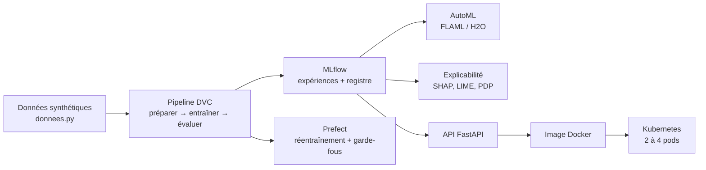

# Pipeline MLOps de bout en bout — détection de fraude

**Fatima Zahra Houqqa** · Élève ingénieure en IA et Data Science (EMSI Rabat) · module MLOps, 2026
[Portfolio](https://houqqa-fatimazahra.github.io) · [LinkedIn](https://linkedin.com/in/houqqa-fatimazahra)

> **EN —** End-to-end MLOps project around a fraud-detection model: versioned data and pipeline (DVC), experiment tracking and model registry (MLflow), AutoML (FLAML, H2O), orchestration with Prefect, explainability (SHAP, LIME, PDP), and a FastAPI service packaged with Docker and deployed on Kubernetes (rolling update with **0 failed requests out of 394**).

Ce dépôt suit le cycle de vie complet d'un modèle, des données jusqu'à la production. Chaque étape a son compte rendu dans [`reports/`](reports/).



## Résultats clés

| Étape | Ce qui a été mesuré |
|---|---|
| Modèle (forêt aléatoire) | F1 **0,8636** sur 1 250 transactions de test (précision 0,877, rappel 0,851) |
| AutoML | H2O : F1 0,8623, latence médiane ~63 ms · FLAML (LightGBM) : F1 0,8359, ~11 ms, modèle de 43 Ko |
| Reproductibilité | même probabilité (**0,8899**) pour le même dossier sur la machine, dans Docker et dans Kubernetes |
| Kubernetes | passage de 2 à 4 pods en une commande · pod supprimé remplacé en 3 s · mise à jour progressive : **0 erreur sur 394 requêtes** · version en panne bloquée puis retour arrière, 0 erreur sur 513 |
| Garde-fous | refus automatique d'un modèle sous le seuil de F1 (0,82) ou qui utilise une variable connue seulement après la décision |

## Technologies

Python · scikit-learn · **DVC** · **MLflow** · **FLAML** · H2O AutoML · **Prefect** · Node-RED · SHAP · LIME · InterpretML (EBM) · Orange · KNIME · **FastAPI** · **Docker** · **Kubernetes** (kind)

## Organisation du dépôt

| Dossier / fichier | Contenu |
|---|---|
| `donnees.py` | génère le jeu de données synthétique (5 000 transactions) |
| `dvc.yaml`, `params.yaml` | pipeline reproductible et ses paramètres |
| `src/` | préparation, entraînement, évaluation, AutoML, explicabilité, équité |
| `flow_mlops.py`, `src/flow_xai.py` | flux Prefect : réentraînement et contrôle d'explicabilité |
| `fraude-api/` | API FastAPI, `Dockerfile` et manifestes Kubernetes (`k8s/`) |
| `MODEL_CARD.md` | fiche du modèle : usages, performances, équité, limites |
| `reports/` | comptes rendus des TP 5 à 9, métriques et captures |

## Lancer le projet

```bash
python donnees.py                 # recrée data/transactions.csv
dvc repro                         # rejoue le pipeline préparer → entraîner → évaluer
mlflow server --host 127.0.0.1 --port 5001 --backend-store-uri sqlite:///mlflow.db
python flow_mlops.py              # flux Prefect de réentraînement
```

API, Docker et Kubernetes :

```bash
cd fraude-api
docker build -t fraude-api:1.0 .
docker run -p 8000:8000 fraude-api:1.0          # puis http://localhost:8000/docs
kind create cluster
kind load docker-image fraude-api:1.0
kubectl apply -f k8s/
```

## Parcours TP 1 à 9

Les TP 1 à 4 posent les bases (suivi, pipeline, versionnement) ; les TP 5 à 9 ont chacun un compte rendu détaillé.

- **TP 1 — Découverte de la boîte à outils MLOps** : génération des données ([`donnees.py`](donnees.py)), entraînement d'une forêt aléatoire suivi dans MLflow (autolog, 5 combinaisons d'hyperparamètres) — [`src/train.py`](src/train.py), [`run_tp1.ps1`](run_tp1.ps1)
- **TP 2 — Structurer le pipeline** : étapes préparer → entraîner → évaluer, paramètres centralisés et projet MLflow — [`src/preparer.py`](src/preparer.py), [`src/entrainer.py`](src/entrainer.py), [`src/evaluer.py`](src/evaluer.py), [`params.yaml`](params.yaml), [`MLproject`](MLproject)
- **TP 3 — Versionner données et pipeline avec DVC** : jeu de données v2 suivi par DVC, pipeline reproductible `dvc repro` et métriques — [`dvc.yaml`](dvc.yaml), [`dvc.lock`](dvc.lock), [`reports/metrics.json`](reports/metrics.json)
- **TP 4 — Expériences DVC** : comparaison de variantes de profondeur (meilleur F1 0,8659 à profondeur 16) — [`exp_table.txt`](exp_table.txt)
- [TP 5 — AutoML et low-code (FLAML, Orange, KNIME)](reports/compte-rendu-tp5.md)
- [TP 6 — AutoML H2O / FLAML et déploiement MLflow](reports/compte-rendu-tp6.md)
- [TP 7 — Automatiser les workflows (Prefect, Node-RED)](reports/compte-rendu-tp7.md)
- [TP 8 — Explicabilité (SHAP, LIME, PDP, EBM, équité)](reports/compte-rendu-tp8.md)
- [TP 9 — Docker et Kubernetes](reports/compte-rendu-tp9.md)

## Limites

Les données sont **synthétiques** (5 000 lignes, 4 variables) : les performances indiquées ne disent rien d'un usage réel. Les limites du modèle (biais sur l'ancienneté, instabilité de LIME, sensibilité à l'échelle des montants) sont détaillées dans [`MODEL_CARD.md`](MODEL_CARD.md).
