# TP 10 — Construire, déployer et sécuriser l'API REST du modèle

**Compte rendu** · Fatima Zahra Houqqa · Partie 8 du cours (MLOps)

## Sommaire

1. [Environnement et déroulement](#1-environnement-et-déroulement)
2. [Partie A — Flask contre FastAPI](#2-partie-a--flask-contre-fastapi)
3. [Partie B — L'API en six étapes, tests et mesures](#3-partie-b--lapi-en-six-étapes-tests-et-mesures)
4. [Partie C — Les 8 attaques et ce qui les bloque](#4-partie-c--les-8-attaques-et-ce-qui-les-bloque)
5. [Bilan](#5-bilan)
6. [Réponses aux questions](#6-réponses-aux-questions)
7. [Écarts avec l'énoncé](#7-écarts-avec-lénoncé)

---

## 1. Environnement et déroulement

| Élément | Version |
|---|---|
| Système | Windows 11 Home, PowerShell 5.1 |
| Python (`.venv`) | 3.13.9 |
| Bibliothèques machine | fastapi 0.165.0, uvicorn 0.54.0, Flask 3.1.3, requests 2.34.2, pytest 9.2.0, httpx2 2.16.2, trustme 1.2.1, python-dotenv 1.2.3, scikit-learn 1.9.1 |
| Docker Desktop | 29.1.2 ; image `python:3.12-slim` |
| Image `fraude-api:securisee` | 691 Mo sur disque / 157 Mo de contenu, ID `737cd5e212f8` |

Le dossier suivi est celui de **Mme Benali** : `{"montant": 1800, "anciennete": 30, "freq_24h": 4, "nuit": 1}`. Il donne **0,8899** partout : Flask, FastAPI, API v1, version lente, version sécurisée en HTTPS, conteneur sécurisé.

Tout le TP est dans le dossier `tp10-api/` : `api/` (main, main_lent, brouillon, main_securisee), `tests/`, `attaques/`, `appel.py`, `Dockerfile`, `Dockerfile.mauvais`, `bilan-tp10.md`. Les sorties brutes sont dans `reports/tp10_sorties.txt`, les captures dans `reports/captures/tp10/`.

| Étape | Résultat obtenu | Attendu par l'énoncé |
|---|---|---|
| 2. Flask / FastAPI | Flask **500** (page HTML), FastAPI **422** (`float_parsing`, `loc: body, montant`) | identique |
| 4. Codes HTTP | 200, 200, 200 (0,8899), 422 `greater_than`, 422 `extra_forbidden`, 405, 404 | identique |
| 5. Tests | **5 passed** in 4.62s | 5 passed |
| 6. Chargement | une fois : médiane **55,9 ms** ; à chaque appel : **199,8 ms** (×3,6) | 21,5 / 82,1 ms (×3,8) |
| 7. Processus | 1 processus **17 req/s** ; 2 processus **32 req/s** | 27 / 83 req/s |
| 8. Terrain | clé de 43 caractères, certificat trustme, les deux API répondent 0,8899 | identique |
| 9. HTTPS | HTTP : clé `admin` + dossier lus ; HTTPS : octets `16 03 01 …` | identique |
| 10. Clé | brouillon : clé trouvée en **11 essais** ; sécurisée : **14 × 401** | identique |
| 11. Secrets | `ENV API_KEY=k3y-ex3mple-2026` dans `docker history` et `printenv` ; rien dans l'image sécurisée | identique |
| 12. Validation | brouillon : 200, 200, 500, 200, 500, 500 ; sécurisée : **6 × 422** | identique |
| 13. Débit | brouillon 100 × 200 ; sécurisée **60 × 200 + 40 × 429** | identique |
| 14. Erreurs | brouillon `debug=True` : 500 de **5 182 caractères** ; corrigé : **21** ; sécurisée : 422 | 5 420 / 21 / 422 |
| 15. Conteneurs | `mauvais` : **root**, fichier pirate créé ; `securisee` : **app**, *Permission denied* | identique |
| 16. Journal | brouillon : `cle=admin donnees={...}` ; sécurisée : id/version/proba/durée + 14 × 401, 7 × 422, 42 × 429 | identique |
| 17. Nettoyage | conteneurs supprimés, `fraude-api:mauvais` supprimée, `fraude-api:securisee` gardée | identique |

---

## 2. Partie A — Flask contre FastAPI

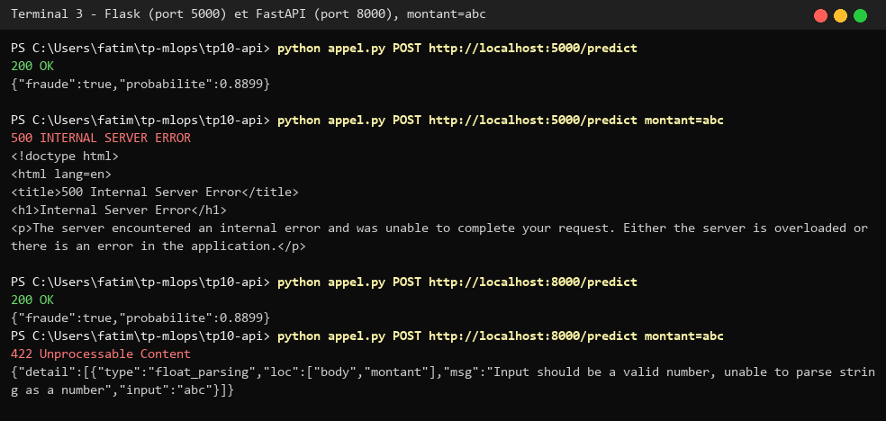

Pour la même erreur du client (`montant=abc`), Flask plante dans `predict_proba` (`ValueError: could not convert string to float: 'abc'`) et renvoie **500 INTERNAL SERVER ERROR** avec une page HTML. FastAPI refuse la requête avant d'appeler le modèle : **422 Unprocessable Content**, en JSON, avec le champ fautif (`loc: ["body","montant"]`). Le terminal Flask affiche aussi *« WARNING: This is a development server. Do not use it in a production deployment »*.

---

## 3. Partie B — L'API en six étapes, tests et mesures

`tp10-api/api/main.py` applique les six étapes : modèle chargé une fois ; schéma `Transaction` (types, bornes `Field`, `extra="forbid"`) ; schéma `Prediction` (version du modèle et identifiant de requête) ; routes `/health`, `/v1/model-info`, `/v1/predict` ; journal sans donnée client ; tests.

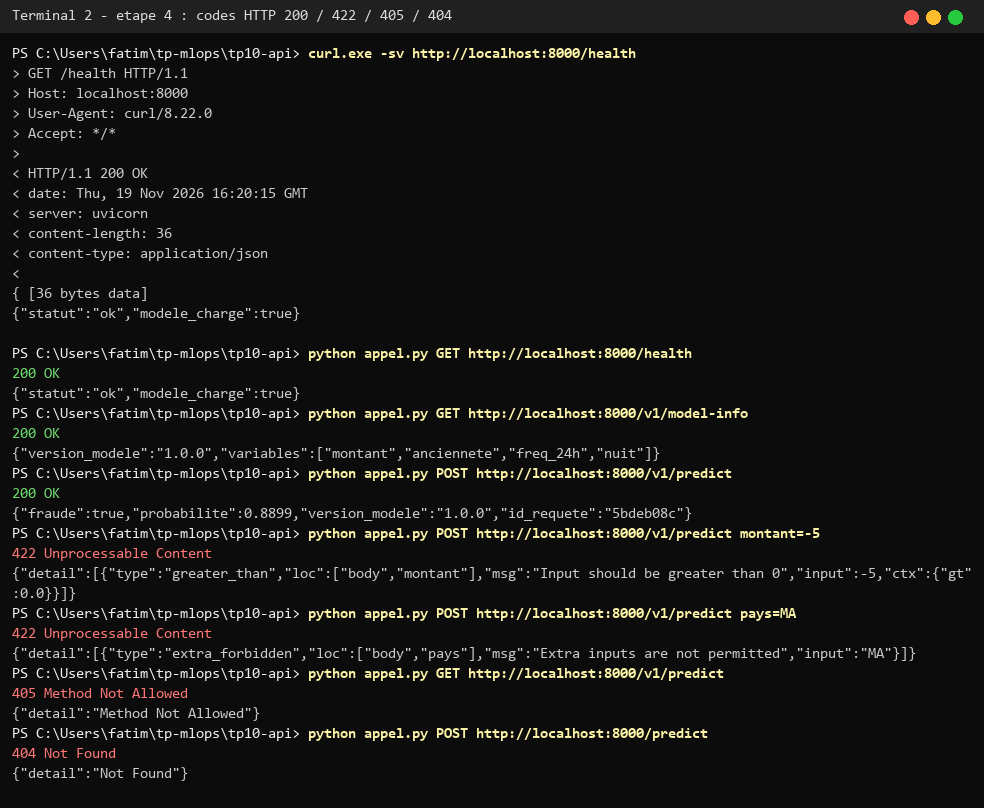

`curl.exe -sv` montre la requête (`> GET /health HTTP/1.1`, `Host`, `User-Agent: curl/8.22.0`) et la réponse (`< HTTP/1.1 200 OK`, `server: uvicorn`, `content-type: application/json`). La page `http://localhost:8000/docs` présente le contrat généré à partir des schémas ; un montant de 0 y donne 422.

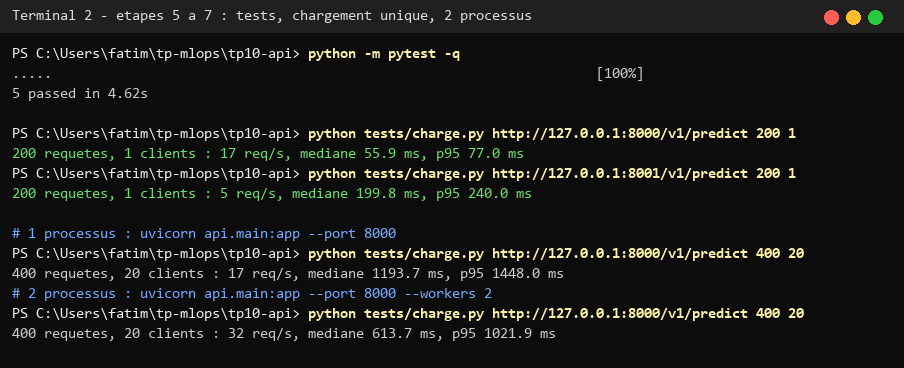

- **Tests** : `5 passed`.
- **Étape 6** : la version qui recharge le fichier de 8 Mo à chaque requête est **3,6 fois plus lente** (199,8 ms contre 55,9 ms de médiane) pour la même probabilité.
- **Étape 7** : avec 20 clients, un processus traite les requêtes à la file (17 req/s, médiane 1,19 s). Avec `--workers 2`, le débit passe à **32 req/s** et la médiane tombe à 0,61 s. Le terminal 1 montre `Started parent process` puis deux `Started server process`.

---

## 4. Partie C — Les 8 attaques et ce qui les bloque

Le brouillon (`api/brouillon.py`) tourne en HTTP sur le port 8001, la version sécurisée (`api/main_securisee.py`) en HTTPS sur 8443, avec la clé lue dans `.env` et le certificat créé par `trustme`.

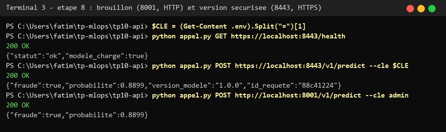

### Pratique 1 — HTTPS

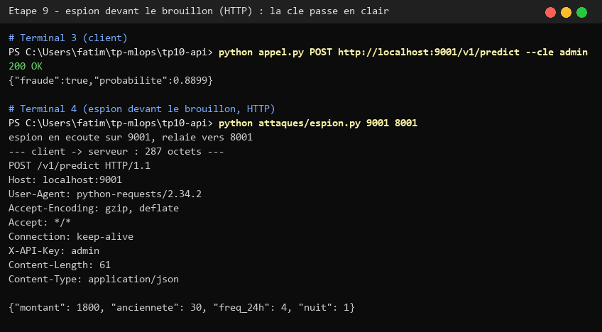
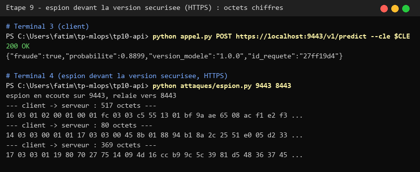

En HTTP, l'espion lit toute la requête : `X-API-Key: admin` et le dossier du client. En HTTPS, il ne voit que des octets chiffrés (`16 03 01 …` = début de la poignée de main TLS, puis `17 03 03 …` = données chiffrées), et le client reçoit quand même 0,8899.

### Pratique 2 — Clé d'API

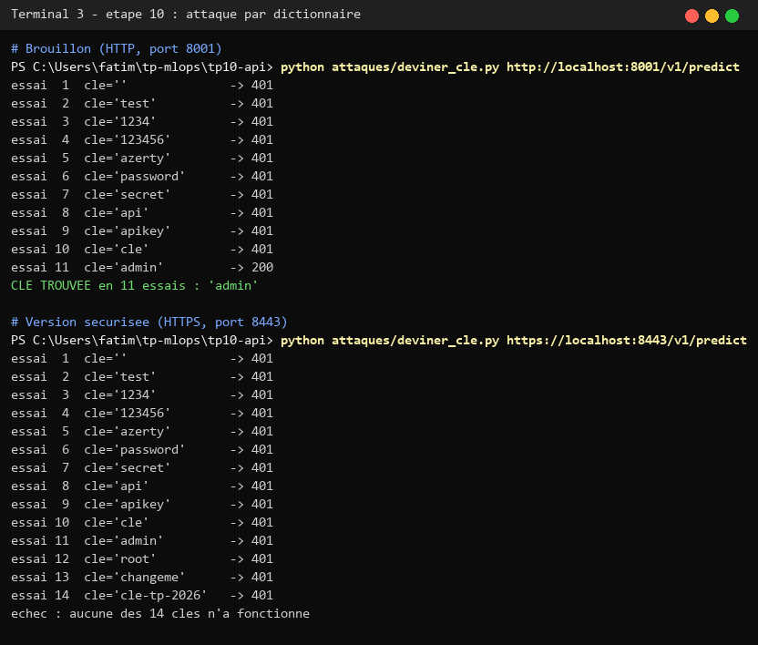

La clé `admin` du brouillon est trouvée en 11 essais. La clé de la version sécurisée fait 43 caractères aléatoires (`secrets.token_urlsafe(32)`) et est comparée à temps constant (`secrets.compare_digest`) : les 14 essais échouent (401).

### Pratique 3 — Secrets

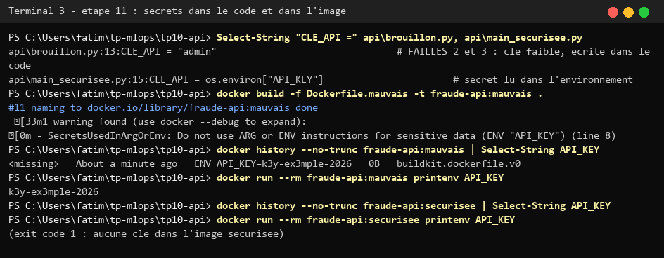

Docker avertit dès la construction (`SecretsUsedInArgOrEnv`). Dans l'image mauvaise, `docker history` et `printenv` donnent la clé `k3y-ex3mple-2026`. L'image sécurisée ne contient ni clé ni `.env` (exclu par `.dockerignore`) : `printenv API_KEY` ne renvoie rien.

### Pratique 4 — Validation

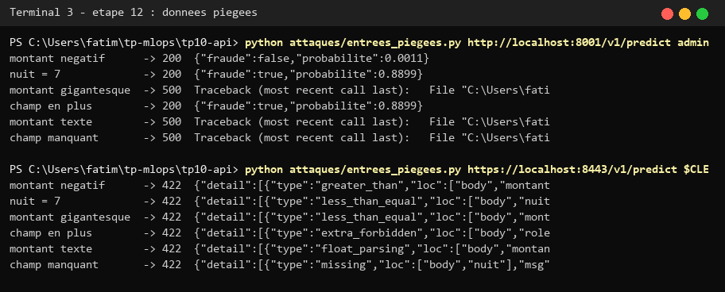

Le brouillon donne une probabilité pour un montant négatif (0,0011) et pour `nuit = 7` (0,8899), accepte `role="admin"`, et plante (500) sur le reste. La version sécurisée renvoie six fois 422, avec le type de l'erreur (`greater_than`, `less_than_equal`, `extra_forbidden`, `float_parsing`, `missing`).

### Pratique 5 — Limite de débit

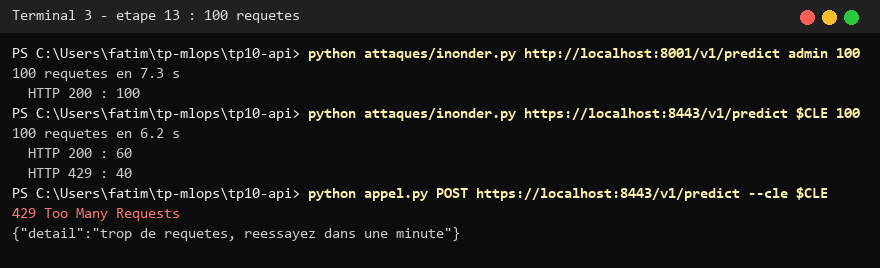

Le brouillon accepte les 100 requêtes. La version sécurisée en accepte 60 puis répond 429 ; l'appel suivant reçoit encore *« trop de requetes, reessayez dans une minute »*.

### Pratique 6 — Erreurs discrètes

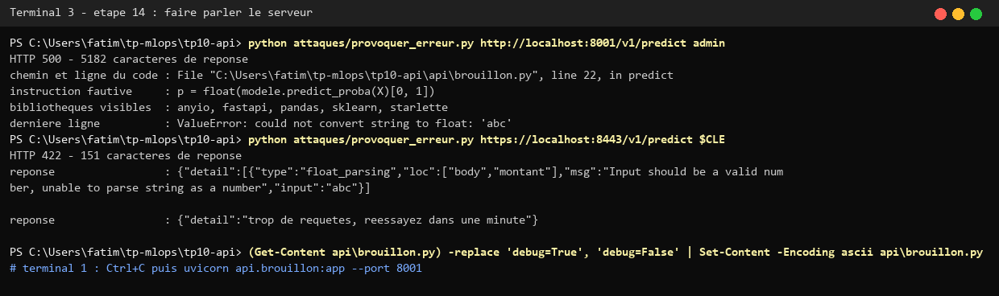

Avec `debug=True`, la réponse 500 du brouillon fait 5 182 caractères : chemin `…\tp10-api\api\brouillon.py`, ligne 22, instruction fautive et bibliothèques (`anyio, fastapi, pandas, sklearn, starlette`). Après passage à `debug=False`, il ne reste que `Internal Server Error` (21 caractères). La version sécurisée répond 422 avant toute erreur.

### Pratique 7 — Conteneur sans privilèges

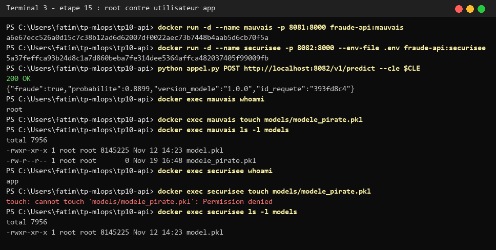

Le conteneur `mauvais` tourne en `root` : `touch models/modele_pirate.pkl` réussit. Le conteneur `securisee` tourne en `app` (`RUN useradd --create-home app` + `USER app`) : *Permission denied*. Il a reçu sa clé par `--env-file .env` et répond 0,8899.

### Pratique 8 — Journal

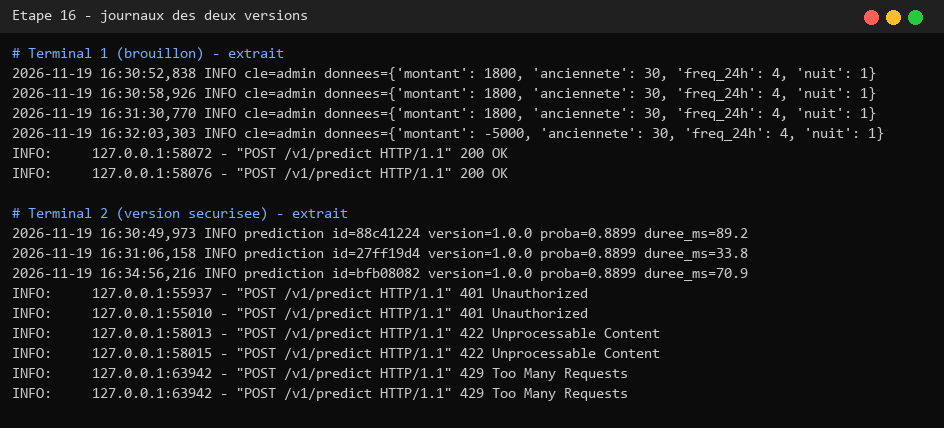

Le journal du brouillon contient la clé et le dossier à chaque appel (`cle=admin donnees={'montant': 1800, ...}`). Celui de la version sécurisée ne contient que `prediction id=… version=1.0.0 proba=0.8899 duree_ms=…`, jamais la clé (vérifié par une recherche de la clé dans le journal : aucun résultat). Ses codes racontent l'attaque : **14 × 401** (dictionnaire), **7 × 422** (entrées piégées), **42 × 429** (inondation).

---

## 5. Bilan

Le fichier `tp10-api/bilan-tp10.md` contient les deux tableaux complétés :

| Mesure | req/s | médiane | p95 |
|---|---|---|---|
| Modèle chargé une seule fois | 17 | 55,9 ms | 77,0 ms |
| Modèle rechargé à chaque appel | 5 | 199,8 ms | 240,0 ms |
| 1 processus, 20 clients | 17 | 1 193,7 ms | 1 448,0 ms |
| 2 processus, 20 clients | 32 | 613,7 ms | 1 021,9 ms |

| Pratique | Attaque | Brouillon | Version sécurisée |
|---|---|---|---|
| 1 HTTPS | espion | clé et dossier lus en clair | octets chiffrés |
| 2 Clé d'API | dictionnaire | trouvée en 11 essais | 14 × 401 |
| 3 Secrets | docker history | clé visible (history + printenv) | aucune clé |
| 4 Validation | entrées piégées | 3 × 200 absurdes, 3 × 500 | 6 × 422 |
| 5 Limite de débit | 100 requêtes | 100 × 200 | 60 × 200, 40 × 429 |
| 6 Erreurs discrètes | montant = abc | 500, 5 182 caractères de trace | 422 (brouillon corrigé : 21 car.) |
| 7 Sans privilèges | touch dans models/ | root, fichier créé | app, Permission denied |
| 8 Journal | lecture des logs | clé + données client | id, version, proba, durée |

---

## 6. Réponses aux questions

**1. Flask 500 ou FastAPI 422 ?** FastAPI aide le développeur de l'application cliente. Un 500 dit « le serveur a planté » sans dire pourquoi, avec une page HTML difficile à exploiter dans du code : le client ne sait pas si c'est sa faute. Le 422 dit que c'est la requête qui est fausse, en JSON, avec le champ (`body.montant`), le type d'erreur (`float_parsing`) et la valeur reçue (`abc`) : il peut corriger tout de suite.

**2. 404, 405, 422.** **404** : l'adresse n'existe pas (`/predict` a été remplacée par `/v1/predict`). **405** : l'adresse existe mais pas avec cette méthode (GET sur une route qui n'accepte que POST). **422** : adresse et méthode correctes, mais le corps ne respecte pas le schéma (montant négatif, champ `pays` en plus). Le serveur a compris la requête et la refuse.

**3. Médianes de l'étape 6.** 55,9 ms (chargé une fois) contre 199,8 ms (rechargé), rapport **3,6**. Les cinq tests passent avec `main_lent.py`, car ils ne vérifient que le résultat (code HTTP, probabilité, version), qui est identique : le défaut ne touche que le temps. Il aurait fallu un **test de performance** (de charge) : par exemple, vérifier que la médiane sur 100 appels reste sous un seuil (50 ou 100 ms), ou que `duree_ms` dans le journal reste bas.

**4. Débits de l'étape 7.** 17 req/s avec 1 processus, 32 req/s avec 2. Avec `--workers 2`, la limite de 60 par minute **n'est plus respectée exactement** : le compteur `appels` est un dictionnaire en mémoire, propre à chaque processus. Chaque processus compte ses propres 60 requêtes, et la clé peut donc obtenir jusqu'à 120 réponses par minute selon la façon dont les requêtes sont réparties. Il faut un compteur partagé (Redis) ou une passerelle devant l'API.

**5. Clé longue en HTTP.** Non. L'espion lit l'en-tête `X-API-Key` tel quel, qu'il fasse 5 ou 43 caractères : une clé aléatoire résiste à la devinette, pas à l'écoute. Il faut toujours **combiner une clé forte et HTTPS** (et garder la clé hors du code).

**6. Essais de clés illimités.** Les 401 ne passent pas par `limiter_debit`. Protection : limiter aussi les **échecs d'authentification par adresse IP** (par exemple 10 échecs par minute, puis 429 ou blocage temporaire avec un délai qui augmente), dans l'API (compteur par IP dans `verifier_cle`) ou dans une passerelle/pare-feu (Nginx `limit_req`, fail2ban, WAF). Une alerte sur les rafales de 401 permet aussi de réagir.

**7. `.env` dans `.gitignore` et `.dockerignore`.** Ce sont deux canaux de fuite différents. `.gitignore` empêche la clé d'entrer dans le dépôt Git (historique, GitHub). `.dockerignore` empêche `COPY` de la mettre dans une couche de l'image, que n'importe qui peut récupérer avec l'image. Dans un cas comme dans l'autre, une clé publiée doit être considérée comme compromise. En production, la clé est dans un **coffre à secrets** (HashiCorp Vault, AWS Secrets Manager, Azure Key Vault, Secret Kubernetes) et elle est injectée comme variable d'environnement au démarrage.

**8. `nuit = 7` plus dangereux qu'un 500.** Un 500 se voit : le client sait que ça a échoué et le journal montre l'erreur. Une probabilité pour `nuit = 7` a l'air d'une réponse normale (200, 0,8899) alors qu'elle n'a aucun sens : le modèle n'a jamais vu cette valeur. La mauvaise décision (bloquer ou laisser passer une transaction) est prise en silence, sans alerte, et peut aussi servir à un attaquant pour explorer le modèle avec des valeurs hors domaine.

**9. Code ou déploiement ?**
- **Code de l'API** : 2 clé d'API (vérification à temps constant), 4 validation (schéma), 5 limite de débit (`limiter_debit`, ici en mémoire), 6 erreurs discrètes (`debug=False`), 8 journal sans donnée sensible.
- **Déploiement** : 1 HTTPS (certificat sur uvicorn, ou plutôt Nginx/passerelle en production), 3 secrets (`.env` hors image, coffre à secrets, `--env-file`), 7 conteneur sans privilèges (`USER app` dans le Dockerfile).
- Certaines sont aux deux : le débit et le journal sont souvent repris par la passerelle et l'outil de supervision ; le secret est lu par le code (`os.environ`) mais fourni par le déploiement.

---

## 7. Écarts avec l'énoncé

- **Flask et `.env`** : `flask run` lit automatiquement un fichier `.env` trouvé en remontant les dossiers ; un fichier personnel `C:\Users\fatim\.env`, sans rapport avec le TP, le faisait planter (`UnicodeDecodeError`). Flask a été lancé avec `FLASK_SKIP_DOTENV=1`.
- **Mesures (étapes 6 et 7)** : sous Windows, `localhost` essaie d'abord IPv6 (`::1`) alors qu'uvicorn n'écoute qu'en IPv4 : environ 2 s de plus par nouvelle connexion. Les mesures de charge ont donc été faites sur `http://127.0.0.1:8000` (même serveur, même code). Les valeurs absolues diffèrent de l'énoncé (machine différente) ; le rapport ×3,6 de l'étape 6 et le gain ×1,9 de l'étape 7 vont dans le même sens.
- **Étape 13, brouillon** : un premier essai a eu un dépassement de délai (`ReadTimeout`) pendant la construction des images Docker en parallèle ; relancé : 100 × 200 en 7,3 s.
- **Étape 14, version sécurisée** : lancée juste après l'étape 13, elle a d'abord répondu **429** (la minute de la limite n'était pas écoulée), ce qui montre d'ailleurs que la limite fonctionne. Rejouée après redémarrage du serveur (compteur en mémoire remis à zéro) : **422**, 151 caractères.
- **Docker** : la première construction de l'image mauvaise a échoué sur des délais réseau vers pypi.org ; relancée, elle a réutilisé le cache de l'image sécurisée.
- **Plusieurs terminaux** : les serveurs (terminaux 1, 2 et 4) ont été lancés en arrière-plan, avec leur sortie redirigée dans des fichiers ; les captures « terminal » ont été produites à partir des sorties réelles de `reports/tp10_sorties.txt`.
- Versions : fastapi 0.165.0 et Flask 3.1.3 sur la machine (énoncé : « égales ou plus récentes ») ; le modèle `model.pkl` affiche un avertissement `InconsistentVersionWarning` (picklé avec scikit-learn 1.8.0, lu avec 1.9.1) sans effet sur le résultat : 0,8899 partout.
