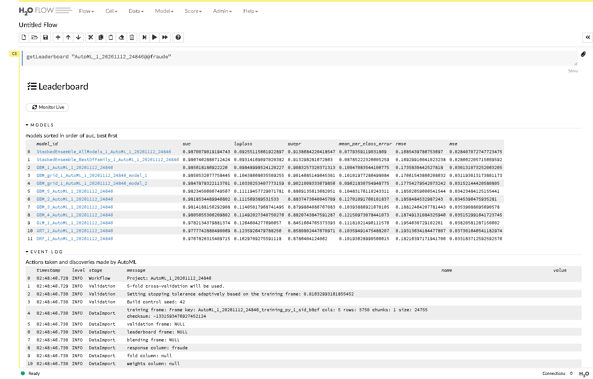
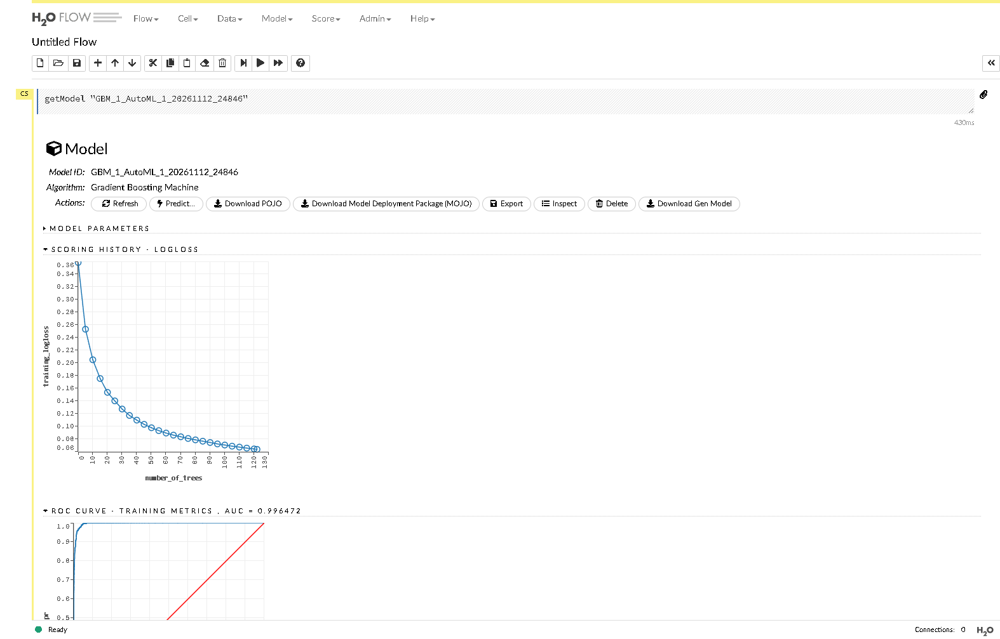
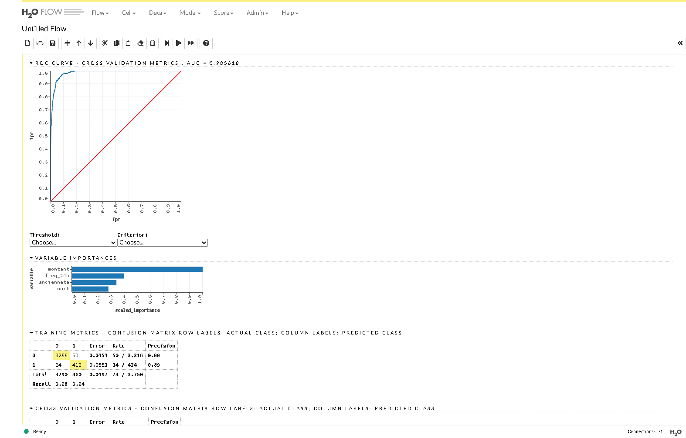
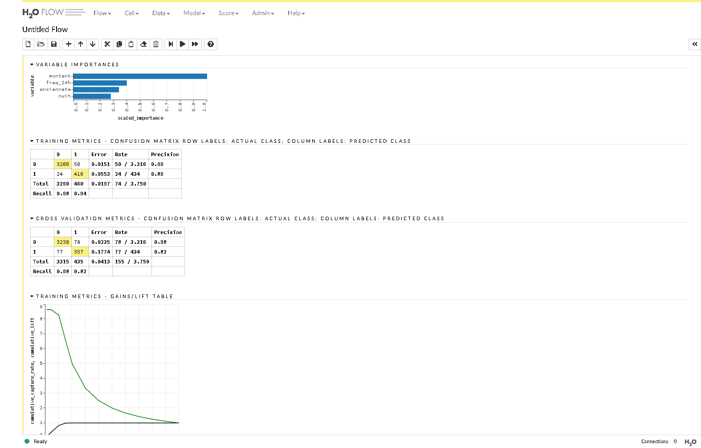
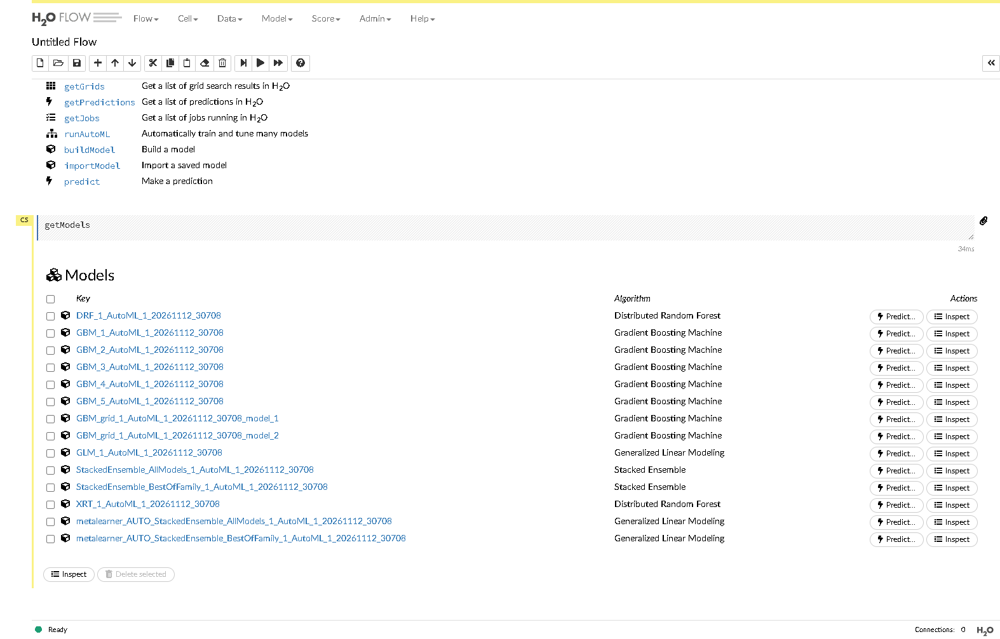
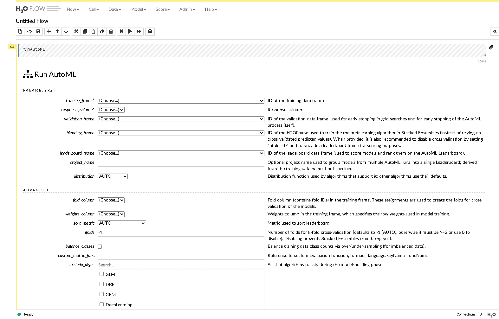
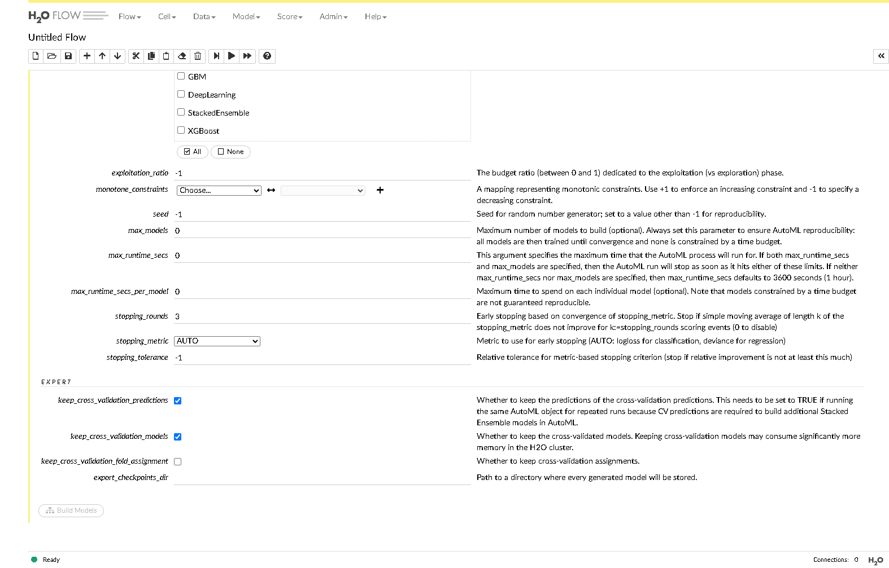
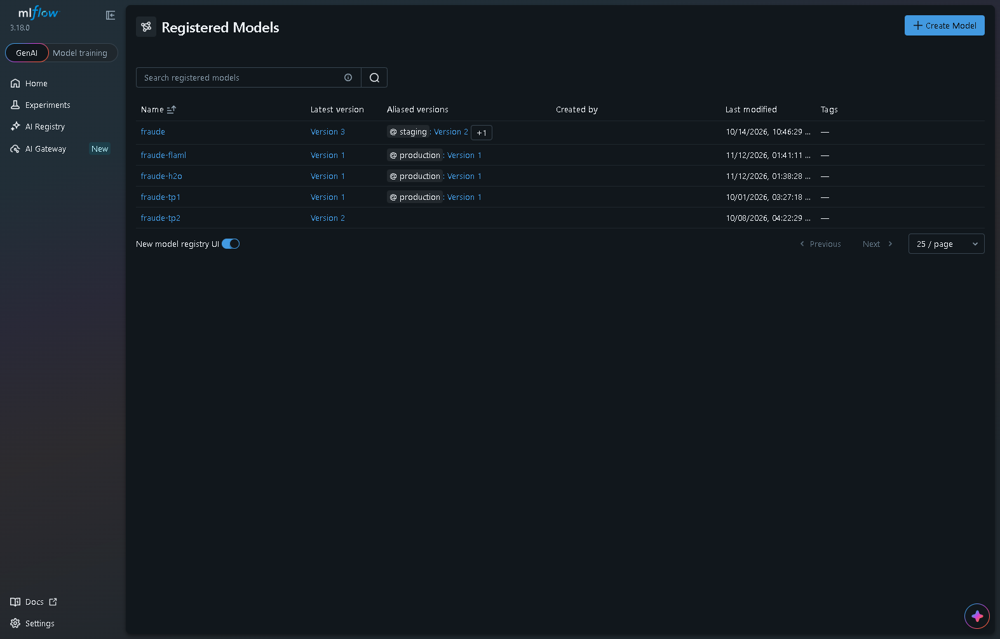
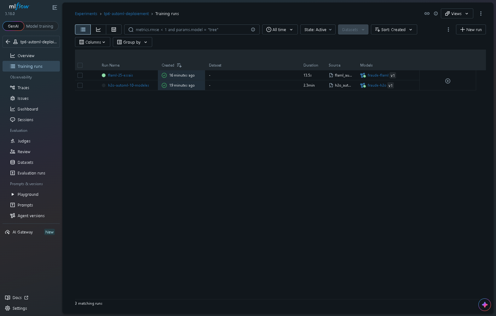

# TP 6 — Créer et déployer un modèle via une plateforme AutoML

**Compte rendu** · Fatima Zahra Houqqa · Partie 5 du cours (MLOps)

## Sommaire

1. [Environnement et déroulement](#1-environnement-et-déroulement)
2. [Livrable 1 — Les scripts](#2-livrable-1--les-scripts)
3. [Livrable 2 — Captures de H2O Flow](#3-livrable-2--captures-de-h2o-flow)
4. [Livrable 3 — Capture du registre MLflow](#4-livrable-3--capture-du-registre-mlflow)
5. [Livrable 4 — Sorties du client et erreur de l'étape 7](#5-livrable-4--sorties-du-client-et-erreur-de-létape-7)
6. [Livrable 5 — Tableau comparatif complété et commenté](#6-livrable-5--tableau-comparatif-complété-et-commenté)
7. [Réponses aux questions](#7-réponses-aux-questions)
8. [Écarts avec l'énoncé](#8-écarts-avec-lénoncé)

---

## 1. Environnement et déroulement

| Élément | Version |
|---|---|
| Système | Windows 11, PowerShell |
| Java | Temurin 17.0.20 (H2O-3 n'accepte que Java 8 à 17) |
| Python | 3.13.9 (environnement `.venv`) |
| H2O-3 | 3.46.0.12 |
| MLflow | 3.18.0 |
| FLAML | 2.7.0 (LightGBM 4.7.0) |

Quatre processus tournent pendant le TP :

| Terminal | Rôle | Commande |
|---|---|---|
| 1 | plateforme H2O (port 54321) | `java -jar <h2o>\backend\bin\h2o.jar -port 54321` |
| — | serveur MLflow (port **5001**, voir § 8) | `mlflow server --host 127.0.0.1 --port 5001 --backend-store-uri sqlite:///mlflow.db` |
| 3 | point de terminaison H2O (port 8100) | `mlflow models serve -m 'models:/fraude-h2o@production' -p 8100 --env-manager local` |
| 4 | point de terminaison FLAML (port 8101) | `mlflow models serve -m 'models:/fraude-flaml@production' -p 8101 --env-manager local` |

Résumé des étapes :

| Étape | Résultat |
|---|---|
| 1. Démarrer H2O | serveur H2O 3.46.0.12 démarré, H2O Flow accessible sur http://127.0.0.1:54321 |
| 2. AutoML H2O | projet `AutoML_1_20261112_23749`, 12 modèles, leader **StackedEnsemble_AllModels**, AUC (CV) 0.9870, **F1 test = 0.8623**, enregistré comme `fraude-h2o` v1 |
| 3. Exploration H2O Flow | 5-fold CV, graine 42, importances et matrices relevées (§ 3) |
| 4. Promotion et déploiement | alias `production` → `fraude-h2o` v1, servi sur le port 8100 |
| 5. Client et latence | médiane **61 à 65 ms**, p95 81 à 123 ms |
| 6. FLAML | leader **lgbm**, **F1 test = 0.8359**, `fraude-flaml` v1 en `production`, servi sur 8101 : médiane **10 à 12 ms** |
| 7. Panne contrôlée | redémarrage d'H2O → erreur **400** `Object ... not found` sur 8100 ; 8101 non concerné |
| 8. Comparaison | tableau complété (§ 6) |

---

## 2. Livrable 1 — Les scripts

Les scripts lisent l'adresse MLflow dans la variable `MLFLOW_TRACKING_URI` (par défaut `http://127.0.0.1:5000`, comme dans l'énoncé). Avant de les lancer : `$env:MLFLOW_TRACKING_URI = "http://127.0.0.1:5001"`.

### `src/h2o_automl.py`

Même découpage qu'aux TP 1 à 5. Budget en **nombre de modèles** avec une **graine**, et Deep Learning exclu, pour que la recherche soit reproductible.

```python
import os
import h2o, pandas as pd, mlflow, mlflow.h2o
from h2o.automl import H2OAutoML
from sklearn.model_selection import train_test_split
from sklearn.metrics import f1_score
h2o.init(url='http://127.0.0.1:54321')                                # la plateforme du terminal 1
df = pd.read_csv('data/transactions.csv')
tr, te = train_test_split(df, test_size=0.25, random_state=42)        # decoupage des TP 1 a 5
htr = h2o.H2OFrame(tr, destination_frame='fraude_train')
hte = h2o.H2OFrame(te, destination_frame='fraude_test')
for f in (htr, hte):
    f['fraude'] = f['fraude'].asfactor()                              # classification, pas regression
aml = H2OAutoML(max_models=10, seed=42,                               # budget en modeles : reproductible
                exclude_algos=['DeepLearning'],                       # non reproductible par defaut
                sort_metric='AUC')
aml.train(y='fraude', training_frame=htr)
print('projet AutoML :', aml.project_name)                            # pour le retrouver dans H2O Flow
lb = aml.leaderboard.as_data_frame()
print(lb[['model_id', 'auc', 'logloss']].head(8).to_string(index=False))
pred = aml.leader.predict(hte).as_data_frame()['predict'].astype(int)
f1 = f1_score(te['fraude'], pred)
print('modele retenu :', aml.leader.model_id, '| F1 test =', round(f1, 4))
mlflow.set_tracking_uri(os.environ.get('MLFLOW_TRACKING_URI', 'http://127.0.0.1:5000'))
mlflow.set_experiment('tp6-automl-deploiement')
with mlflow.start_run(run_name='h2o-automl-10-modeles'):
    mlflow.log_params({'outil': 'h2o', 'max_models': 10, 'modele': aml.leader.model_id})
    mlflow.log_metric('f1', f1)
    mlflow.h2o.log_model(aml.leader, name='model', input_example=te.drop(columns='fraude').head(3),
                         registered_model_name='fraude-h2o')
```

Sortie :

```text
projet AutoML : AutoML_1_20261112_23749
                                              model_id      auc  logloss
   StackedEnsemble_AllModels_1_AutoML_1_20261112_23749 0.987008 0.092551
StackedEnsemble_BestOfFamily_1_AutoML_1_20261112_23749 0.986746 0.093142
                         GBM_1_AutoML_1_20261112_23749 0.985618 0.098490
            GBM_grid_1_AutoML_1_20261112_23749_model_1 0.985053 0.104387
            GBM_grid_1_AutoML_1_20261112_23749_model_2 0.984788 0.103303
                         GBM_5_AutoML_1_20261112_23749 0.982345 0.111195
                         GBM_2_AutoML_1_20261112_23749 0.981853 0.111569
                         GBM_3_AutoML_1_20261112_23749 0.981419 0.114050
modele retenu : StackedEnsemble_AllModels_1_AutoML_1_20261112_23749 | F1 test = 0.8623
Successfully registered model 'fraude-h2o'.
Created version '1' of model 'fraude-h2o'.
```

**Reproductibilité vérifiée** : la même recherche a été relancée deux fois pour les captures (projets `..._24846` et `..._30708`) ; les AUC sont identiques au millionième (0.987008 / 0.986746 / 0.985618).

### `src/flaml_automl.py`

Budget de 25 essais avec une graine. Le format `cloudpickle` est obligatoire : le format par défaut de MLflow (skops) refuse les modèles LightGBM.

```python
import os
import pandas as pd, joblib, mlflow, mlflow.sklearn
from flaml import AutoML
from sklearn.model_selection import train_test_split
from sklearn.metrics import f1_score
df = pd.read_csv('data/transactions.csv')
X, y = df.drop(columns='fraude'), df['fraude']
Xtr, Xte, ytr, yte = train_test_split(X, y, test_size=0.25, random_state=42)
a = AutoML()
a.fit(Xtr, ytr, task='classification', metric='f1', time_budget=-1,
      max_iter=25, seed=42, verbose=0)                                # budget en essais : reproductible
f1 = f1_score(yte, a.predict(Xte))
print('modele retenu :', a.best_estimator, '| F1 test =', round(f1, 4))
modele = a.model.estimator                                            # le modele sous-jacent (LightGBM, XGBoost...)
joblib.dump(modele, 'models/model_flaml.pkl')
mlflow.set_tracking_uri(os.environ.get('MLFLOW_TRACKING_URI', 'http://127.0.0.1:5000'))
mlflow.set_experiment('tp6-automl-deploiement')
with mlflow.start_run(run_name='flaml-25-essais'):
    mlflow.log_params({'outil': 'flaml', 'max_iter': 25, 'modele': a.best_estimator})
    mlflow.log_metric('f1', f1)
    mlflow.sklearn.log_model(modele, name='model', input_example=Xte[:3],
                             serialization_format='cloudpickle',      # skops refuse LightGBM
                             registered_model_name='fraude-flaml')
```

Sortie :

```text
modele retenu : lgbm | F1 test = 0.8359
Successfully registered model 'fraude-flaml'.
Created version '1' of model 'fraude-flaml'.
```

### `src/client.py`

Envoie une transaction suspecte (8 500 MAD, client récent, nuit), puis chronomètre 50 appels. Le port est passé en argument (8100 pour H2O, 8101 pour FLAML).

```python
import sys, time, statistics, requests
PORT = sys.argv[1] if len(sys.argv) > 1 else '8100'                  # 8100 : H2O, 8101 : FLAML
URL = f'http://127.0.0.1:{PORT}/invocations'
CORPS = {'dataframe_records': [{'montant': 8500.0, 'anciennete': 3,
                                'freq_24h': 9, 'nuit': 1}]}
r = requests.post(URL, json=CORPS, timeout=10)
print('reponse :', r.status_code, r.json())
lat = []
for _ in range(50):                                                   # 50 appels pour mesurer
    t = time.perf_counter()
    requests.post(URL, json=CORPS, timeout=10)
    lat.append((time.perf_counter() - t) * 1000)
lat.sort()
print('mediane', round(statistics.median(lat), 1), 'ms')
print('p95    ', round(lat[int(0.95 * len(lat))], 1), 'ms')
```

### `src/promouvoir.py` (étapes 4 et 6)

C'est le bloc `@' ... '@ | python -` de l'énoncé, mis dans un fichier pour servir aux deux modèles.

```python
import os, sys
import mlflow
from mlflow import MlflowClient
NOM = sys.argv[1] if len(sys.argv) > 1 else 'fraude-h2o'             # fraude-h2o ou fraude-flaml
mlflow.set_tracking_uri(os.environ.get('MLFLOW_TRACKING_URI', 'http://127.0.0.1:5000'))
c = MlflowClient()
v = max(int(m.version) for m in c.search_model_versions(f"name='{NOM}'"))
c.set_registered_model_alias(NOM, 'production', v)                  # derniere version
print('version', v, 'promue')
```

```text
> python src/promouvoir.py fraude-h2o
version 1 promue
> python src/promouvoir.py fraude-flaml
version 1 promue
```

---

## 3. Livrable 2 — Captures de H2O Flow

### 3.1 Le classement (leaderboard)

Commande tapée dans H2O Flow : `getLeaderboard "AutoML_1_20261112_24846@@fraude"` puis Ctrl+Entrée.



- **12 modèles** : 10 modèles de base (GBM, GLM, DRF, XRT) + 2 Stacked Ensembles, triés par AUC.
- **EVENT LOG** : « 5-fold cross-validation will be used » et « **Build control seed: 42** ».
- Le meilleur modèle est `StackedEnsemble_AllModels` (AUC 0.9870). Le meilleur modèle simple est **GBM_1** (AUC 0.9856) ; il n'y a pas de XGBoost (voir § 8).

### 3.2 Fiche d'un modèle : GBM_1





- **Courbe ROC** en validation croisée : AUC = 0.9856.
- **Ordre des variables (VARIABLE IMPORTANCES)** : `montant` (1.0), loin devant `freq_24h` (≈ 0.40), `anciennete` (≈ 0.34) et `nuit` (≈ 0.28).

### 3.3 Matrices de confusion TRAINING et CROSS VALIDATION



| GBM_1 | Fraudes reconnues | Fraudes manquées | Fausses alertes | Erreur totale | Rappel fraude |
|---|---|---|---|---|---|
| TRAINING | 410 / 434 | 24 | 50 / 3 316 | 1,97 % | 0,94 |
| CROSS VALIDATION | 357 / 434 | 77 | 78 / 3 316 | 4,13 % | 0,82 |

**La matrice TRAINING est la plus optimiste**, parce que le modèle y est évalué sur les lignes qu'il a apprises. En validation croisée, chaque ligne est prédite par un modèle qui ne l'a jamais vue. C'est donc la seconde matrice qui estime le comportement réel en production.

### 3.4 Menus Model > List All Models et Model > Run AutoML...



Le serveur contient **14 modèles** : les 12 du classement et les 2 méta-modèles GLM (`metalearner_AUTO_StackedEnsemble_...`) qui combinent les prédictions dans les ensembles.





Ce formulaire fait le même lancement que `src/h2o_automl.py`, à la souris. Il n'a **pas été lancé**. Par défaut, `seed = -1`, `max_models = 0` et `max_runtime_secs = 0` : sans limite, H2O prend un budget de **3 600 s**. Le formulaire indique lui-même qu'il faut toujours fixer `max_models` pour la reproductibilité.

---

## 4. Livrable 3 — Capture du registre MLflow



`fraude-h2o` et `fraude-flaml` sont en **version 1** avec l'alias **`@production`**. Les modèles des TP précédents (`fraude`, `fraude-tp1`, `fraude-tp2`) sont toujours présents.



L'expérience `tp6-automl-deploiement` contient les deux runs : `h2o-automl-10-modeles` (2,3 min) et `flaml-25-essais` (13,5 s), chacun relié à son modèle enregistré.

---

## 5. Livrable 4 — Sorties du client et erreur de l'étape 7

### 5.1 Port 8100 — modèle H2O

```text
> python src/client.py 8100
reponse : 200 {'predictions': [{'predict': 1, 'p0': 1.2088511188834694e-05, 'p1': 0.9999879114888112}]}
serie 1 : mediane 65.2 ms | p95  90.7 ms
serie 2 : mediane 62.3 ms | p95 123.2 ms
serie 3 : mediane 61.1 ms | p95  80.7 ms
```

Le modèle H2O renvoie la classe **et** les deux probabilités : fraude à 99,999 %.

### 5.2 Port 8101 — modèle FLAML

```text
> python src/client.py 8101
reponse : 200 {'predictions': [1]}
serie 1 : mediane 10.8 ms | p95 16.6 ms
serie 2 : mediane 12.1 ms | p95 14.3 ms
serie 3 : mediane 12.3 ms | p95 13.9 ms
```

Même décision (fraude), environ **5 à 6 fois plus vite**. FLAML ne renvoie que la classe.

### 5.3 Étape 7 — panne contrôlée

**a) H2O arrêté (Ctrl+C dans le terminal 1), appel du port 8101 :**

```text
> python src/client.py 8101
reponse : 200 {'predictions': [1]}
mediane 10.3 ms
p95     12.2 ms
```

Le service FLAML n'est **pas concerné** : il ne dépend pas d'H2O.

**b) H2O redémarré, point de terminaison 8100 non relancé — erreur obtenue :**

```text
400 BAD_REQUEST
h2o.exceptions.H2OResponseError: Server error water.exceptions.H2OKeyNotFoundArgumentException:
  Error: Object 'StackedEnsemble_AllModels_1_AutoML_1_20261112_23749' not found in function: predict for argument: model
  Request: POST /4/Predictions/models/StackedEnsemble_AllModels_1_AutoML_1_20261112_23749/frames/...
```

Le modèle vivait dans la mémoire du serveur H2O : au redémarrage, il a disparu, alors que le point de terminaison continuait de tourner.

**c) `mlflow models serve` relancé sur 8100 :**

```text
> python src/client.py 8100
reponse : 200 {'predictions': [{'predict': 1, 'p0': 1.2088511188834694e-05, 'p1': 0.9999879114888112}]}
1re serie (a froid) : mediane 271.3 ms | p95 304.3 ms
series suivantes    : mediane 61.7 a 64.8 ms
```

Le modèle est rechargé dans le nouveau serveur H2O et le service répond de nouveau. La première série est plus lente, le temps du chargement à froid.

---

## 6. Livrable 5 — Tableau comparatif complété et commenté

Tailles relevées : dossier MLflow du modèle H2O (`mlartifacts/5/models/m-e6488c2b.../artifacts`), `models/model_flaml.pkl` et `models/model.pkl`. Le tableau est aussi dans `reports/tp6_comparaison.md`.

| Critère | Manuel (TP 3) | H2O AutoML | FLAML |
|---|---|---|---|
| F1 sur le jeu test | **0.8669** | 0.8623 | 0.8359 |
| Modèle retenu | forêt 300 arbres | Stacked Ensemble | LightGBM |
| Latence médiane | non servi | 61 à 65 ms | **10 à 12 ms** |
| Latence p95 | non servi | 81 à 123 ms | **14 à 17 ms** |
| Taille du modèle | 16.1 Mo (\*) | 5.1 Mo | **43 Ko** |
| Dépendances en prod | Python | Python + Java 17 + serveur H2O | Python + lightgbm |
| Survit à un redémarrage d'H2O | oui | **non** (erreur 400) | oui |
| Explicabilité | bonne : un seul algorithme, importances | faible : méta-modèle sur 10 modèles de base | bonne : un seul modèle d'arbres, importances et SHAP |

(\*) `models/model.pkl` est aujourd'hui la forêt du pipeline DVC (600 arbres, profondeur 20), plus lourde que la forêt 300 du TP 3 (7.8 Mo dans l'énoncé).

**Commentaire.**
- **Qualité :** les trois modèles sont proches. Le réglage manuel garde le meilleur F1. H2O gagne 0.026 de F1 sur FLAML, une différence faible à l'échelle de 1 250 transactions de test.
- **Coût en production :** H2O coûte environ **5 fois plus de latence** et **120 fois plus de place** que FLAML, et demande une **JVM et un serveur à état** à maintenir en vie. L'étape 7 montre qu'un simple redémarrage de ce serveur casse le service sans que l'endpoint ne s'arrête.
- **Explicabilité :** le Stacked Ensemble est le plus difficile à justifier auprès d'un client.
- **Conclusion :** pour un service de paiement en temps réel, FLAML (ou le modèle manuel du TP 3) offre le meilleur compromis. H2O est utile pour **explorer** rapidement de nombreux algorithmes, moins pour **servir** le modèle.

---

## 7. Réponses aux questions

**1. Le modèle retenu par H2O est un Stacked Ensemble. Qu'est-ce que c'est, et qu'est-ce que cela change pour expliquer une décision à un client dont la carte a été bloquée ?**

C'est un modèle à deux niveaux. Les modèles de base (ici les GBM, GLM, DRF et XRT de l'AutoML) produisent chacun une probabilité de fraude. Un méta-modèle (un GLM chez H2O) apprend ensuite à combiner ces probabilités, à partir des prédictions de validation croisée. Il gagne quelques millièmes d'AUC (0.9870 contre 0.9856 pour GBM_1).

Pour un client dont la carte a été bloquée, l'explication devient difficile. La décision dépend de dix modèles et des poids du méta-modèle : on ne peut plus dire simplement « le montant et l'heure ont pesé tant ». Il faudrait des méthodes après coup (SHAP sur l'ensemble), coûteuses et approximatives. Dans un secteur réglementé comme la banque, où le client a droit à une explication, c'est un vrai handicap.

**2. Pourquoi avoir fixé `max_models`, `seed` et exclu Deep Learning ? Qu'aurait-on perdu avec `max_runtime_secs=60` ?**

Pour la **reproductibilité**. Avec un budget en nombre de modèles et une graine, deux exécutions entraînent exactement les mêmes modèles et donnent le même classement : vérifié ici sur trois exécutions, avec des AUC identiques. Deep Learning est exclu parce qu'il n'est pas déterministe par défaut (calcul parallèle multi-thread).

Avec `max_runtime_secs=60`, le nombre de modèles entraînés dépend de la vitesse et de la charge de la machine. Deux exécutions, ou deux postes, peuvent produire des classements et des leaders différents : « deux exécutions, deux scores ». On perd aussi la possibilité de comparer honnêtement deux versions du jeu de données, puisqu'un écart de score pourrait venir de la machine et non des données. Le formulaire Run AutoML de H2O Flow (§ 3.4) le confirme : il conseille de toujours fixer `max_models`.

**3. La latence du modèle H2O est environ 50 fois celle du modèle FLAML pour la même décision. D'où vient cet écart ? Quel modèle choisiriez-vous pour autoriser un paiement en temps réel ?**

Le service MLflow d'un modèle H2O n'est qu'un relais. À chaque appel, il :
1. convertit le JSON en DataFrame pandas ;
2. l'envoie au serveur Java H2O en HTTP, qui crée un `H2OFrame` ;
3. lance un job de prédiction sur 10 modèles + le méta-modèle ;
4. rapatrie le résultat et le reconvertit.

Le modèle FLAML est un objet LightGBM chargé dans le même processus Python : un appel direct, sans aller-retour réseau ni conversion.

Mesuré sur ce poste : ≈ 63 ms contre ≈ 11 ms, soit un rapport de **5 à 6** (50 dans l'énoncé ; le rapport dépend du poste). Pour autoriser un paiement en temps réel, où le budget de latence total est de quelques dizaines de millisecondes, je choisirais **FLAML** : même décision, F1 proche, latence et p95 bien plus faibles et plus stables.

**4. À l'étape 7, que révèle le message « Object ... not found » sur l'architecture du service H2O ? Comment détecteriez-vous automatiquement cette panne (TP 7) ?**

Le service H2O n'est pas autonome. Le modèle vit dans la **mémoire du serveur H2O** (la JVM), pas dans le processus qui sert l'API : l'endpoint ne garde que l'identifiant du modèle. Quand H2O redémarre, sa mémoire est vidée et l'identifiant ne pointe plus sur rien. L'endpoint reste « vivant » (`/ping` répond) mais échoue sur chaque prédiction. Il y a deux composants à état, couplés, qui peuvent tomber séparément.

Pour la détecter automatiquement :
- une **sonde de santé applicative** qui envoie régulièrement une vraie transaction de test sur `/invocations`, et pas seulement sur `/ping` ;
- le suivi du **taux de réponses 4xx/5xx** et de la latence dans le monitoring (Prometheus/Grafana), avec une alerte au-delà d'un seuil ;
- un redémarrage automatique du service de prédiction quand la sonde échoue (readiness/liveness probe).

**5. Le réglage manuel du TP 3 a le meilleur F1. Quel modèle déploieriez-vous en production, et sur quels critères autres que le F1 ?**

Le modèle manuel a le meilleur F1 (0.8669), mais l'écart avec H2O (0.8623) et FLAML (0.8359) doit être pesé avec d'autres critères :
- **latence** et p95, essentiels pour un paiement en temps réel ;
- **dépendances** et robustesse : pas de JVM ni de serveur à état (étape 7) ;
- **taille** du modèle : 43 Ko pour FLAML, contre 16 Mo pour la forêt ;
- **explicabilité** : un seul modèle d'arbres, avec importances et SHAP ;
- **reproductibilité** et coût de maintenance.

Je déploierais la forêt du TP 3 ou le LightGBM de FLAML, **pas le Stacked Ensemble H2O**. Le choix entre les deux dépend du coût métier d'une fraude manquée face à celui d'une fausse alerte. Le F1 seul ne suffit pas : il faut aussi fixer un seuil de décision adapté à ce coût.

**6. Que faut-il conserver pour pouvoir reconstruire à l'identique le modèle H2O dans deux ans ?**

Le format binaire H2O n'est lisible que par la même version d'H2O, et l'export autonome MOJO est réservé à l'édition commerciale. Il faut donc conserver :
- le **script** `src/h2o_automl.py`, versionné dans Git ;
- les **données exactes**, versionnées avec **DVC** (`data/transactions.csv.dvc`) ;
- le **découpage** : `test_size=0.25`, `random_state=42` ;
- les **paramètres de l'AutoML** : `max_models=10`, `seed=42`, `exclude_algos=['DeepLearning']`, `sort_metric='AUC'` ;
- la **version exacte d'H2O (3.46.0.12) et de Java (17)** ;
- le **système d'exploitation** : le classement dépend de la disponibilité de XGBoost, absent sous Windows ;
- les versions des bibliothèques Python (`pip freeze`) ;
- l'**artefact binaire** du modèle, dans le registre MLflow.

---

## 8. Écarts avec l'énoncé

- **Port MLflow 5001 au lieu de 5000.** Sur ce poste, le port 5000 est occupé par une autre application. Le serveur MLflow a été lancé sur le port 5001, et les scripts lisent `MLFLOW_TRACKING_URI`. Le reste est identique.
- **Pas de XGBoost dans H2O.** Le journal affiche « XGBoost is not available; skipping it » : l'extension XGBoost d'H2O-3 n'est pas fournie sous Windows. Les 10 modèles de base sont donc des GBM, GLM, DRF et XRT. Le classement diffère de celui de l'énoncé, le F1 du Stacked Ensemble vaut **0.8623** au lieu de 0.8464, et la fiche étudiée à l'étape 3 est celle de **GBM_1** au lieu de XGBoost_2. C'est aussi pourquoi l'ordre des variables diffère : `freq_24h` passe avant `anciennete`.
- **Latence H2O plus basse que dans l'énoncé** : ≈ 63 ms au lieu de 260 à 450 ms. Seule la première série après un redémarrage monte à 271 ms. Le rapport avec FLAML est donc d'environ **5 à 6** au lieu de 50, mais l'ordre de grandeur reste nettement en faveur de FLAML.
- **Captures de l'étape 3 faites après l'étape 7.** Le redémarrage d'H2O avait effacé le projet AutoML. La même recherche a été relancée sans nouvel enregistrement dans MLflow ; les scores sont identiques, ce qui confirme la reproductibilité.
