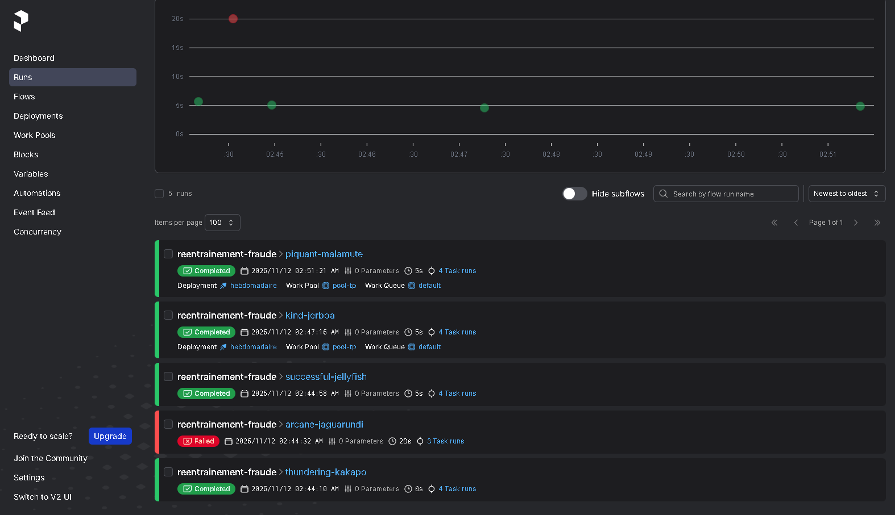
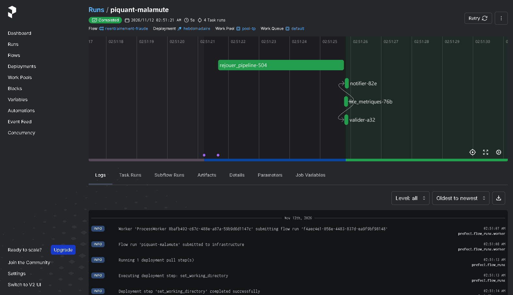
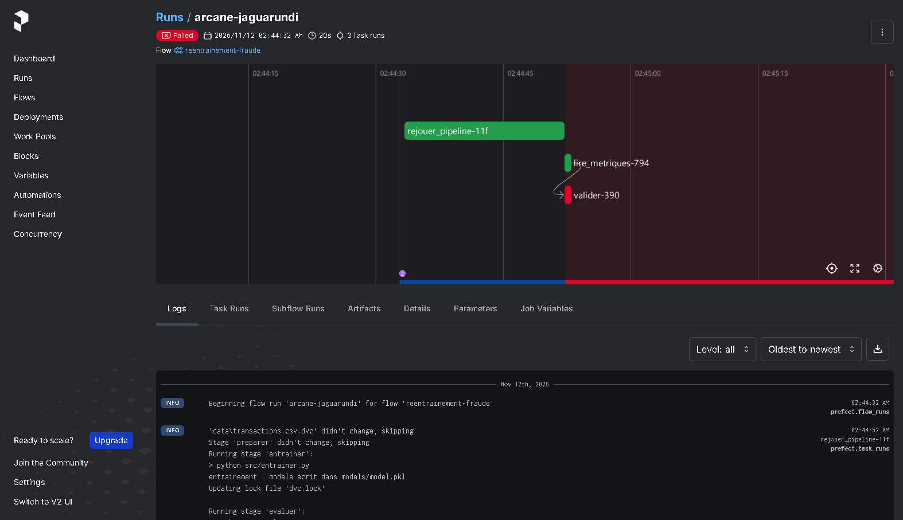
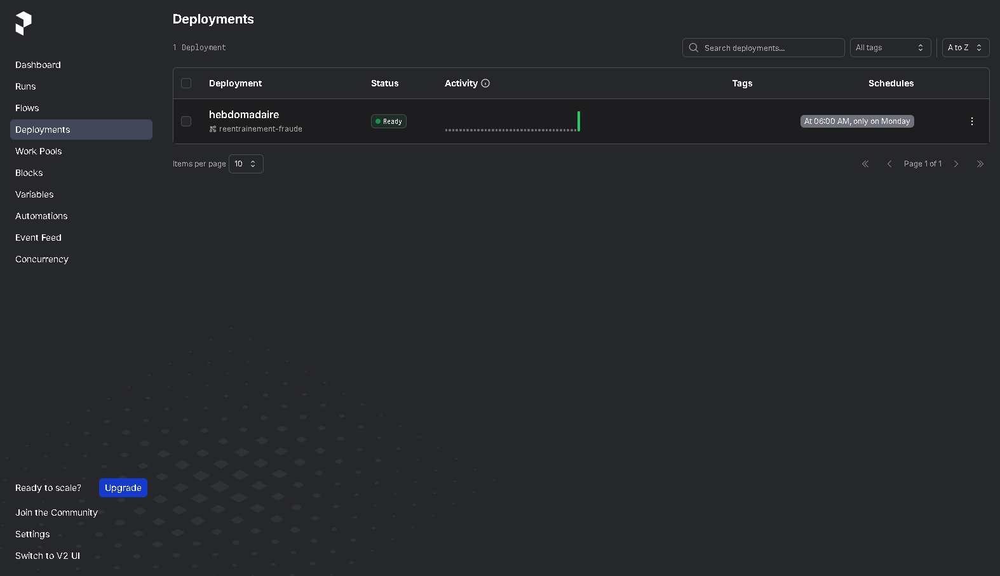
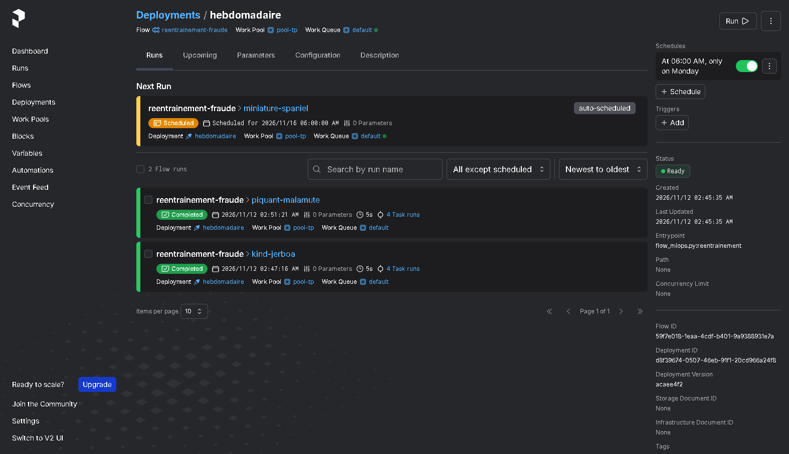
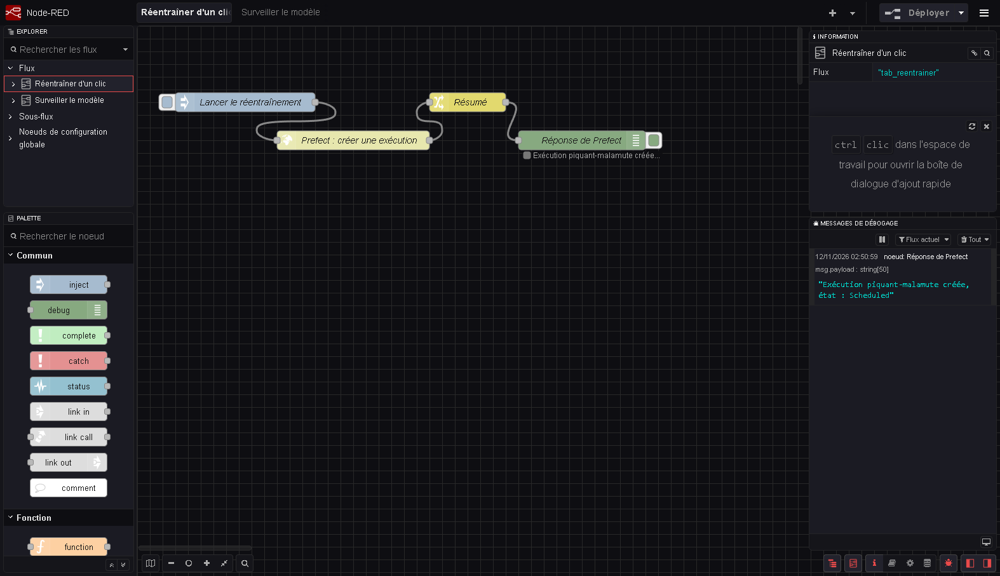
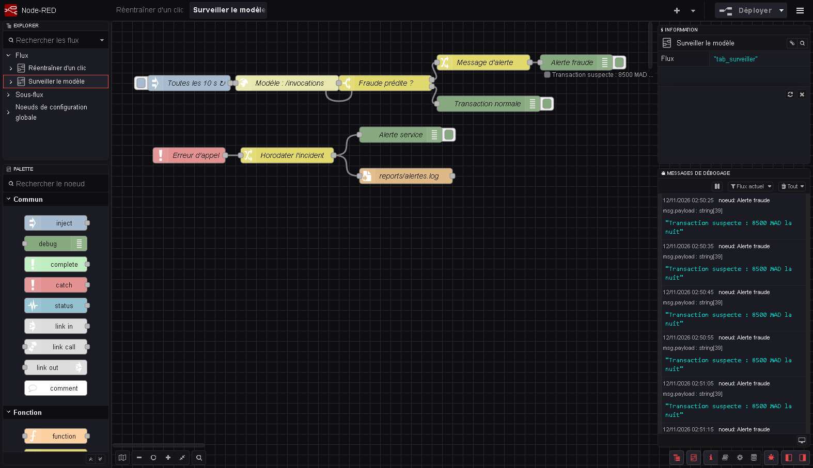
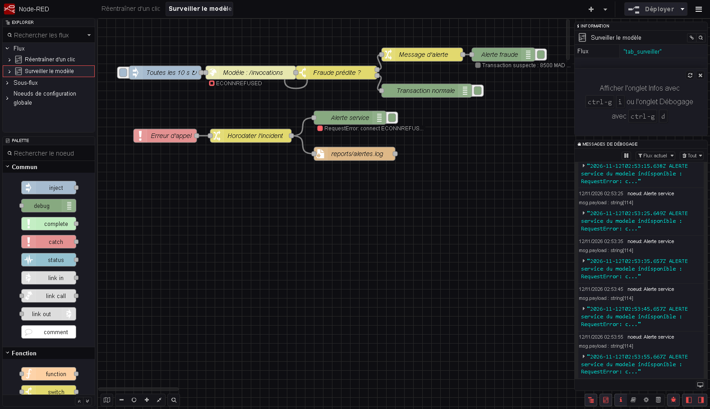

# TP 7 — Automatiser les workflows MLOps

**Compte rendu** · Fatima Zahra Houqqa · Partie 5 du cours (MLOps)

## Sommaire

1. [Environnement et déroulement](#1-environnement-et-déroulement)
2. [Livrable 1 — Le workflow Prefect et l'export Node-RED, commités dans Git](#2-livrable-1--le-workflow-prefect-et-lexport-node-red-commités-dans-git)
3. [Livrable 2 — Tableau de bord Prefect : exécution réussie et exécution échouée](#3-livrable-2--tableau-de-bord-prefect--exécution-réussie-et-exécution-échouée)
4. [Livrable 3 — Onglet Deployments et planification](#4-livrable-3--onglet-deployments-et-planification)
5. [Livrable 4 — Captures de Node-RED](#5-livrable-4--captures-de-node-red)
6. [Livrable 5 — Le fichier reports/alertes.log](#6-livrable-5--le-fichier-reportsalerteslog)
7. [Livrable 6 — Synthèse comparative](#7-livrable-6--synthèse-comparative)
8. [Réponses aux questions](#8-réponses-aux-questions)
9. [Écarts avec l'énoncé](#9-écarts-avec-lénoncé)

---

## 1. Environnement et déroulement

| Élément | Version |
|---|---|
| Système | Windows 11, PowerShell |
| Python | 3.13.9 (environnement `.venv`) |
| Prefect | 3.9.2 |
| Node.js / Node-RED | 24.11.1 / 5.0 (interface en français) |
| MLflow | 3.18.0 |
| DVC | 3.67.1 |

Processus lancés pendant le TP :

| Terminal | Rôle | Commande |
|---|---|---|
| 1 | serveur Prefect et interface web (port 4200) | `prefect server start` |
| 3 | worker qui exécute les déploiements | `prefect worker start --pool pool-tp` |
| 4 | Node-RED (port 1880) | `node-red` |
| 5 | modèle FLAML du TP 6 en service (port 8101) | `mlflow models serve -m 'models:/fraude-flaml@production' -p 8101 --env-manager local` |
| — | serveur MLflow (port **5001**, voir § 9) | `mlflow server --host 127.0.0.1 --port 5001 --backend-store-uri sqlite:///mlflow.db` |

Résumé des étapes :

| Étape | Résultat |
|---|---|
| 1. Serveur d'orchestration | `prefect server start`, tableau de bord sur http://127.0.0.1:4200 ; `PREFECT_API_URL` réglé sur `http://127.0.0.1:4200/api` |
| 2. Workflow | paramètres remis à `n_estimators: 300`, `max_depth: 12` ; exécution `thundering-kakapo` : **F1 0.8636 ≥ 0.82, modèle accepté**, 4 tâches Completed |
| 3. Règle de qualité | `max_depth: 2` → exécution `arcane-jaguarundi` **Failed** : `F1 0.2013 < seuil 0.82 : modele refuse`. Valeur remise à 12 : `successful-jellyfish` repasse au vert (« Stage 'entrainer' is cached ») |
| 4. Planification | pool `pool-tp`, déploiement `reentrainement-fraude/hebdomadaire` (cron `0 6 * * 1`), worker démarré. Prochaine exécution : **lundi 16/11/2026 à 06:00** |
| 5. Quick run depuis l'interface | exécution `kind-jerboa` créée par le bouton Run > Quick run, exécutée par le worker : Completed |
| 6. Node-RED | serveur démarré sur http://127.0.0.1:1880 ; onglets « Réentraîner d'un clic » et « Surveiller le modèle » |
| 7. Flux 1 | clic sur le bouton → « Exécution **piquant-malamute** créée, état : Scheduled », puis Completed dans le worker |
| 8. Flux 2 | service en marche : « Transaction suspecte : 8500 MAD la nuit » toutes les 10 s. Service arrêté : alerte horodatée toutes les 10 s, **9 lignes** dans `reports/alertes.log`. Service relancé : les alertes cessent |
| 9. Versionnage | flux exportés dans `nodered/flows.json` (16 objets), synthèse dans `reports/tp7_synthese.md` |

---

## 2. Livrable 1 — Le workflow Prefect et l'export Node-RED, commités dans Git

### `flow_mlops.py`

Chaque étape du pipeline devient une tâche observable. Le workflow rejoue le pipeline DVC du TP 4 sans rien réécrire.

```python
import json, subprocess, yaml
from prefect import flow, task, get_run_logger

@task(retries=2, retry_delay_seconds=10)                # 2 reessais en cas d'echec
def rejouer_pipeline():
    r = subprocess.run(['dvc', 'repro'], capture_output=True, text=True)
    get_run_logger().info(r.stdout[-800:])
    if r.returncode != 0:
        raise RuntimeError(r.stderr[-500:])
    return 'pipeline rejoue'

@task
def lire_metriques():
    return json.load(open('reports/metrics.json'))

@task
def valider(mets):
    seuil = yaml.safe_load(open('params.yaml'))['validation']['seuil_f1']
    if mets['f1'] < seuil:                              # regle de qualite
        raise ValueError(f"F1 {mets['f1']} < seuil {seuil} : modele refuse")
    get_run_logger().info(f"F1 {mets['f1']} >= {seuil} : modele accepte")
    return True

@task
def notifier(mets):
    get_run_logger().info(f"NOTIFICATION equipe : nouveau modele F1={mets['f1']}")

@flow(name='reentrainement-fraude', log_prints=True)
def reentrainement():
    rejouer_pipeline()
    mets = lire_metriques()
    valider(mets)
    notifier(mets)

if __name__ == '__main__':
    reentrainement()
```

**Étape 2 — exécution réussie** (`python flow_mlops.py`) :

```text
Flow run 'thundering-kakapo' - Beginning flow run 'thundering-kakapo' for flow 'reentrainement-fraude'
Task run 'rejouer_pipeline-975' - Stage 'preparer' didn't change, skipping
                                  Stage 'entrainer' is cached - skipping run, checking out outputs
                                  Stage 'evaluer' is cached - skipping run, checking out outputs
Task run 'rejouer_pipeline-975' - Finished in state Completed()
Task run 'lire_metriques-180' - Finished in state Completed()
Task run 'valider-f94' - F1 0.8636 >= 0.82 : modele accepte
Task run 'notifier-115' - NOTIFICATION equipe : nouveau modele F1=0.8636
Flow run 'thundering-kakapo' - Finished in state Completed()
```

**Étape 3 — arrêt automatique** (`max_depth: 2`) :

```text
Flow run 'arcane-jaguarundi' - Beginning flow run 'arcane-jaguarundi' for flow 'reentrainement-fraude'
evaluation : {'f1': 0.2013, 'precision': 1.0, 'recall': 0.1119}
Task run 'rejouer_pipeline-11f' - Finished in state Completed()
Task run 'lire_metriques-794' - Finished in state Completed()
Task run 'valider-390' - Finished in state Failed('Task run encountered an exception ValueError: F1 0.2013 < seuil 0.82 : modele refuse')
Flow run 'arcane-jaguarundi' - Finished in state Failed('Flow run encountered an exception: ValueError: F1 0.2013 < seuil 0.82 : modele refuse')
```

La tâche `notifier` n'a pas été exécutée : aucun modèle n'a été annoncé. Après avoir remis `max_depth: 12`, la relance (`successful-jellyfish`) retrouve le modèle dans le cache DVC sans réentraîner et repasse au vert avec F1 = 0,8636.

### `nodered/flows.json`

Export des deux onglets (menu > Exporter > tous les flux), soit 16 objets JSON. Chaque nœud a son `type`, son `name`, ses réglages et ses liens `wires`. On y retrouve :

- **l'URL de Prefect** (nœud `Prefect : créer une exécution`) :
  ```json
  "url": "http://127.0.0.1:4200/api/deployments/d8f39674-0507-46eb-91f1-20cd966a24f8/create_flow_run"
  ```
- **le seuil du switch** (nœud `Fraude prédite ?`, propriété `payload.predictions[0]`) :
  ```json
  "rules": [ { "t": "eq", "v": "1", "vt": "num" }, { "t": "eq", "v": "0", "vt": "num" } ]
  ```

Les deux fichiers sont commités dans Git (`git add flow_mlops.py nodered/flows.json`).

---

## 3. Livrable 2 — Tableau de bord Prefect : exécution réussie et exécution échouée



Onglet **Runs** : 5 exécutions du flux `reentrainement-fraude`. 4 sont **Completed** (vert) et `arcane-jaguarundi` est **Failed** (rouge, 3 tâches seulement, car `notifier` n'a pas tourné). `kind-jerboa` et `piquant-malamute` portent le déploiement `hebdomadaire` : elles ont été lancées par l'interface et par Node-RED, puis exécutées par le worker.



Exécution réussie `piquant-malamute` (créée par le bouton Node-RED) : les 4 tâches `rejouer_pipeline`, `lire_metriques`, `valider` et `notifier` sont vertes, avec leurs journaux.



Exécution échouée `arcane-jaguarundi` : la tâche fautive **`valider`** est identifiée en rouge, après `rejouer_pipeline` et `lire_metriques` en vert. Le journal montre le réentraînement avec `max_depth: 2`.

---

## 4. Livrable 3 — Onglet Deployments et planification

```text
> prefect work-pool create --type process pool-tp
Created work pool 'pool-tp'!
> prefect --no-prompt deploy flow_mlops.py:reentrainement --name hebdomadaire --pool pool-tp --cron '0 6 * * 1'
Deployment 'reentrainement-fraude/hebdomadaire' successfully created with id 'd8f39674-0507-46eb-91f1-20cd966a24f8'.
> prefect worker start --pool pool-tp
Worker 'ProcessWorker 8bafb492-c67c-488e-a87a-59b9d6d1147c' started!
```



Le déploiement `hebdomadaire` est **Ready**, planifié « At 06:00 AM, only on Monday ».



La prochaine exécution est créée automatiquement : `miniature-spaniel`, **Scheduled for 2026/11/16 06:00:00 AM** (lundi), marquée *auto-scheduled*. Les deux exécutions déjà passées par ce déploiement sont visibles en dessous.

**Étape 5 — Quick run** : bouton **Run > Quick run** dans cette page. L'exécution `kind-jerboa` est apparue immédiatement, est passée par Running puis Completed, et le worker (terminal 3) a affiché :

```text
Flow run 'kind-jerboa' - Executing deployment step: set_working_directory
Flow run 'kind-jerboa' - Beginning flow run 'kind-jerboa' for flow 'reentrainement-fraude'
Task run 'valider-48e' - F1 0.8636 >= 0.82 : modele accepte
Task run 'notifier-24d' - NOTIFICATION equipe : nouveau modele F1=0.8636
Flow run 'kind-jerboa' - Finished in state Completed()
```

---

## 5. Livrable 4 — Captures de Node-RED

### 5.1 Flux 1 après un clic : réentraîner d'un clic

`inject` « Lancer le réentraînement » (payload JSON `{}`) → `http request` « Prefect : créer une exécution » (POST vers `/api/deployments/<id>/create_flow_run`, retour en objet JSON) → `change` « Résumé » (expression JSONata `'Exécution ' & payload.name & ' créée, état : ' & payload.state.name`) → `debug` « Réponse de Prefect » (affichage aussi sous le nœud).



Barre Debug : **« Exécution piquant-malamute créée, état : Scheduled »**. Quelques secondes plus tard, le worker l'a exécutée :

```text
Flow run 'piquant-malamute' submitted to infrastructure
Flow run 'piquant-malamute' - Beginning flow run 'piquant-malamute' for flow 'reentrainement-fraude'
Flow run 'piquant-malamute' - Finished in state Completed()
```

### 5.2 Flux 2 avant la panne : surveiller le modèle

`inject` « Toutes les 10 s » (transaction de 8 500 MAD, client récent, nuit) → `http request` « Modèle : /invocations » (POST sur le port 8101) → `switch` « Fraude prédite ? » sur `msg.payload.predictions[0]`, règle 1 `== 1`, règle 2 `== 0` → sortie 1 : `change` « Message d'alerte » puis `debug` « Alerte fraude » ; sortie 2 : `debug` « Transaction normale ». En dessous : `catch` « Erreur d'appel » (limité au nœud http request) → `change` « Horodater l'incident » → `debug` « Alerte service » et `write file` vers `reports/alertes.log` (ajout en fin de fichier, saut de ligne, création du dossier).



Service en marche : toutes les 10 s, **« Transaction suspecte : 8500 MAD la nuit »** dans la barre Debug et sous le nœud « Alerte fraude ».

### 5.3 Flux 2 pendant la panne

Panne simulée en arrêtant le service du modèle (terminal 5).



Le nœud « Modèle : /invocations » affiche **ECONNREFUSED**, et « Alerte service » affiche « RequestError: connect ECONNREFUSED ». La barre Debug reçoit une alerte horodatée toutes les 10 s. Aucune panne n'est passée par la sortie « Transaction normale » : le switch utilise `== 0` et non « otherwise ».

Après la relance du service, les alertes ont cessé : le fichier est resté à 9 lignes 25 secondes après le redémarrage, et la barre Debug affiche de nouveau « Transaction suspecte ».

---

## 6. Livrable 5 — Le fichier `reports/alertes.log`

Produit par le flux 2 pendant la panne (environ 1 min 30 entre l'arrêt et la relance du service) :

```text
2026-11-12T02:53:05.642Z ALERTE service du modele indisponible : RequestError: connect ECONNREFUSED 127.0.0.1:8101
2026-11-12T02:53:15.638Z ALERTE service du modele indisponible : RequestError: connect ECONNREFUSED 127.0.0.1:8101
2026-11-12T02:53:25.649Z ALERTE service du modele indisponible : RequestError: connect ECONNREFUSED 127.0.0.1:8101
2026-11-12T02:53:35.657Z ALERTE service du modele indisponible : RequestError: connect ECONNREFUSED 127.0.0.1:8101
2026-11-12T02:53:45.657Z ALERTE service du modele indisponible : RequestError: connect ECONNREFUSED 127.0.0.1:8101
2026-11-12T02:53:55.667Z ALERTE service du modele indisponible : RequestError: connect ECONNREFUSED 127.0.0.1:8101
2026-11-12T02:54:05.680Z ALERTE service du modele indisponible : RequestError: connect ECONNREFUSED 127.0.0.1:8101
2026-11-12T02:54:15.681Z ALERTE service du modele indisponible : RequestError: connect ECONNREFUSED 127.0.0.1:8101
2026-11-12T02:54:25.684Z ALERTE service du modele indisponible : RequestError: connect ECONNREFUSED 127.0.0.1:8101
```

9 incidents, un toutes les 10 secondes, jusqu'à la relance du service à 02:54:31. Les heures sont en UTC (`Z`), comme le renvoie `$now()` de JSONata.

---

## 7. Livrable 6 — Synthèse comparative

Le tableau est aussi dans `reports/tp7_synthese.md`.

| Critère | Prefect (orchestrateur) | Node-RED (low-code) | Chaîne CI (GitHub Actions, GitLab CI) |
|---|---|---|---|
| **Ce qui déclenche l'exécution** | Planification (`cron '0 6 * * 1'`), Quick run dans l'interface, appel API `create_flow_run`, `python flow_mlops.py` | Un événement : clic sur un **inject**, minuterie (10 s), erreur captée par un **catch**, requête HTTP, message MQTT | Un événement Git : `push`, pull request, tag, ou une planification |
| **Qui peut la modifier** | Un développeur Python : le workflow est du code relu et versionné | Tout utilisateur qui a accès à l'éditeur web, à la souris, puis **Deploy** | Un développeur, via un fichier YAML du dépôt modifié par commit et relu en pull request |
| **Ce qui se passe en cas d'échec** | La tâche passe en Failed, le flux s'arrête, l'exécution est rouge avec la tâche fautive et ses journaux ; réessais automatiques possibles (`retries=2`) | Statut rouge sur le nœud ; un **catch** peut alerter et journaliser (`alertes.log`). Sans catch, l'erreur n'apparaît que dans la barre Debug | Le job échoue, le commit ou la pull request est marqué en rouge, la fusion peut être bloquée, l'auteur est notifié |
| **Comment on la versionne** | Directement : `flow_mlops.py` dans Git ; la planification via `prefect deploy` ou un `prefect.yaml` | Indirectement : **export JSON** (`nodered/flows.json`) à commiter ; risque de divergence si on oublie d'exporter | Directement : le YAML vit dans le dépôt à côté du code |
| **Type de tâche adapté** | **Traitements** récurrents en Python : réentraînement, pipeline DVC, validation, scoring par lots | **Brancher** des traitements sur des événements sans code : bouton métier, surveillance, alertes, intégrations d'API | **Valider le code** à chaque modification : tests, lint, construction d'image, déploiement après validation |

**Conclusion.**
- **Prefect exécute et surveille des traitements** récurrents écrits en Python.
- **Node-RED branche ces traitements sur des événements** (un bouton, une minuterie, une erreur) sans code.
- **Une chaîne CI valide le code** à chaque modification.

Les trois sont **complémentaires**.

---

## 8. Réponses aux questions

**1. Quelle différence de rôle entre un orchestrateur (Prefect), un outil d'automatisation low-code (Node-RED) et une chaîne d'intégration continue ?**

- **L'orchestrateur exécute un traitement de données.** Prefect enchaîne des tâches, gère leurs dépendances, leurs réessais, leur planification et garde l'historique de chaque exécution. Il répond à « le réentraînement a-t-il tourné, et comment ? ».
- **L'outil low-code relie des événements à des actions**, sans programmation : un clic, une minuterie, une erreur, une requête HTTP. Node-RED ne fait pas le travail lourd lui-même : ici, il demande à Prefect de lancer le flux et il interroge le modèle en service.
- **La chaîne CI vérifie le code** à chaque modification du dépôt : tests, qualité, construction, déploiement. Elle répond à « ce changement peut-il partir en production ? ».

En résumé : la CI valide le **code**, l'orchestrateur exécute les **traitements**, le low-code branche les **événements**.

**2. Le workflow échoue à 6 h du matin un lundi. Comment l'équipe l'apprend-elle, et que doit-elle trouver ? Comment Node-RED pourrait-il aider ?**

Telle quelle, l'équipe ne l'apprend que si quelqu'un ouvre l'interface Prefect : l'exécution y est rouge. Il faut donc une **notification active** : une *Automation* Prefect déclenchée sur l'état Failed, qui envoie un e-mail, un message Slack ou Teams, ou appelle un webhook.

En ouvrant l'exécution, l'équipe doit trouver : la **tâche fautive** (par exemple `valider`), le **message d'erreur** (« F1 0.2013 < seuil 0.82 : modele refuse »), les **journaux** de chaque tâche, les réessais déjà tentés, la durée, et les **paramètres** utilisés. Le modèle en production n'a pas été remplacé, puisque le flux s'arrête avant `notifier`.

Node-RED pourrait aider en recevant ce webhook (nœud `http in`) et en le redistribuant : message sur la messagerie de l'équipe, ligne dans un journal d'incidents, bouton « relancer » pour l'astreinte. Il pourrait aussi interroger régulièrement l'API Prefect (`/api/flow_runs/filter` sur l'état Failed) et alerter si l'exécution du lundi manque ou a échoué.

**3. Pourquoi avoir mis deux réessais sur la tâche de pipeline, mais aucun sur la tâche de validation ?**

L'échec du pipeline peut être **transitoire** : fichier verrouillé, disque ou réseau momentanément indisponible, mémoire saturée. Une nouvelle tentative 10 secondes plus tard a de bonnes chances de réussir.

L'échec de la validation est **déterministe** : avec les mêmes données et les mêmes paramètres, le F1 sera encore 0,2013 et toujours sous le seuil. Réessayer ne changerait rien, retarderait l'alerte et pourrait masquer un vrai problème de qualité. Un refus sur la règle de qualité est une **décision**, pas une panne : il doit arrêter le flux immédiatement.

**4. Le bouton du flux 1 permet à n'importe qui de relancer le réentraînement. Quels risques voyez-vous, et quelles protections ajouteriez-vous ?**

Risques :
- **Accès sans contrôle** : l'éditeur Node-RED et l'API Prefect sont ouverts sans mot de passe. N'importe qui sur le réseau peut lancer un réentraînement ou modifier le flux.
- **Surcharge** : des clics répétés lancent plusieurs réentraînements en parallèle qui se disputent les mêmes fichiers (`models/model.pkl`, `dvc.lock`).
- **Absence de traçabilité** : on ne sait pas qui a relancé, ni pourquoi.
- **Réentraînement sur des données non validées**, avec un nouveau modèle promu par erreur si la règle de qualité est faible.

Protections :
- authentification sur l'éditeur Node-RED (`adminAuth` dans `settings.js`) et sur l'API Prefect ;
- un tableau de bord séparé pour le bouton, accessible à un rôle précis seulement, sans accès à l'éditeur ;
- une **limite de concurrence** à 1 sur le déploiement Prefect (`concurrency_limit`) et un délai minimal entre deux lancements (nœud `delay` en mode limitation dans Node-RED) ;
- un **journal** de qui a cliqué et quand (paramètre ou tag sur l'exécution) ;
- une validation humaine avant la promotion du nouveau modèle, en plus de la règle de qualité automatique.

**5. Expliquez l'incident de la règle « otherwise » (étape 8). Quelle leçon en tirer pour toute surveillance automatique ?**

Quand le service tombe, le nœud `http request` déclenche une erreur (captée par le `catch`), **mais il transmet aussi un message** à sa sortie, avec le texte de l'erreur dans `msg.payload`. Ce message n'a pas de champ `predictions[0]`. Avec une règle « otherwise », le switch l'envoyait dans sa deuxième sortie, qui s'affichait comme **« Transaction normale »**. Pendant la panne, la surveillance affichait donc des transactions normales : elle masquait l'incident au lieu de le signaler.

Avec `== 0`, ce message ne correspond à aucune règle et n'est pas affiché comme normal ; seul le `catch` réagit. Nos captures le confirment : pendant la panne, aucune « Transaction normale » n'apparaît.

Leçons :
- une surveillance qui classe une panne en cas normal est **pire que pas de surveillance**, car elle donne une fausse assurance ;
- il faut **reconnaître explicitement les cas normaux** et traiter tout le reste comme une anomalie, jamais l'inverse ;
- il faut **tester le cas de panne**, et pas seulement le cas nominal, avant de faire confiance à une alerte ;
- une absence de réponse ou une réponse inattendue doit elle-même déclencher une alerte.

**6. Quels avantages et quels risques voyez-vous à configurer un flux dans une interface graphique plutôt que dans un fichier versionné ? L'export JSON règle-t-il tous les problèmes ?**

Avantages : rapide à construire et à modifier ; lisible par un profil non développeur ; le schéma montre directement le chemin des messages ; test immédiat (bouton inject, barre Debug, statuts sous les nœuds).

Risques : les modifications ne laissent **pas de trace** (qui a changé quoi et pourquoi) ; il n'y a pas de relecture avant le **Deploy** ; l'état déployé peut **diverger** de ce qui est dans Git ; les réglages importants sont cachés dans des boîtes de dialogue (un seuil, une URL, l'identifiant du déploiement Prefect écrit en dur) ; tests automatisés difficiles.

L'export JSON **ne règle pas tout** :
- il dépend d'un geste manuel : si l'on oublie d'exporter, Git n'a pas la dernière version ;
- le JSON est versionné, mais difficile à relire en revue : coordonnées `x`/`y`, identifiants générés, `wires` illisibles ;
- il ne contient pas l'environnement : version de Node-RED, nœuds additionnels installés, `settings.js`, identifiants et secrets ;
- il contient des valeurs propres au poste (l'identifiant du déploiement Prefect, le chemin complet de `alertes.log`) qu'il faut adapter sur un autre poste.

On peut aller plus loin avec le mode **Projects** de Node-RED (dépôt Git intégré à l'éditeur) et des variables d'environnement pour ces valeurs.

**7. Quel événement, autre qu'une date ou un clic, pourrait déclencher le réentraînement ? Comment le détecteriez-vous ?**

- **Une dérive des données ou du modèle.** On compare régulièrement la distribution des transactions récentes à celle de l'entraînement : montant, heure, `freq_24h` (tests de Kolmogorov-Smirnov, PSI, ou Evidently). Si l'écart dépasse un seuil, on appelle `create_flow_run`.
- **Une baisse de performance mesurée.** Quand les vraies étiquettes arrivent (fraudes confirmées par les enquêteurs), on recalcule le F1 sur une fenêtre glissante. S'il passe sous le seuil, on déclenche le réentraînement.
- **L'arrivée de nouvelles données.** Une nouvelle version de `data/transactions.csv` poussée avec DVC, ou un nouveau fichier déposé : détectée par un événement Git ou de stockage, un nœud Node-RED qui surveille un dossier, ou un *trigger* Prefect sur un événement.

Dans Prefect, ces cas se branchent avec les **Triggers/Automations** du déploiement (déclenchement sur un événement). Dans Node-RED, avec un flux qui calcule l'indicateur et appelle l'API, comme le flux 1.

---

## 9. Écarts avec l'énoncé

- **Port MLflow 5001.** Le port 5000 est occupé sur ce poste par une autre application (voir TP 6). Le serveur MLflow et le service du modèle FLAML utilisent `MLFLOW_TRACKING_URI = http://127.0.0.1:5001`. Le reste est identique.
- **Versions** : Prefect 3.9.2 (3.9.0 dans l'énoncé) et MLflow 3.18.0. L'installation de Prefect a fait passer `opentelemetry-api` en 1.45, ce qui empêchait MLflow de démarrer (« cannot import name '_ExtendedAttributes' »). Correction : `opentelemetry-sdk` et `opentelemetry-proto` alignés en 1.45.2 ; `pip check` ne signale plus de conflit.
- **Paramètres remis à 300 / 12.** `params.yaml` contenait 600 et 20 (dernier `dvc exp run` du TP 4) ; ils ont été remis à 300 et 12 comme l'énoncé le demande. `dvc.lock` et `reports/metrics.json` reflètent donc le modèle de référence (F1 0,8636).
- **Node-RED en français** : les menus portent des noms français (« Déployer », « Messages de débogage », « Flux actuel »). Les nœuds, leurs noms et leurs réglages sont ceux de l'énoncé. Les flux ont été déployés en une fois (les deux onglets), puis le bouton du flux 1 a été déclenché.
- **Noms d'exécution** : Prefect les tire au hasard (`piquant-malamute` au lieu de `vermilion-anteater`), ainsi que l'identifiant du déploiement (`d8f39674-...`).
