# TP 8 — Appliquer des techniques XAI

**Compte rendu** · Fatima Zahra Houqqa · Partie 6 du cours (MLOps)

## Sommaire

1. [Environnement et déroulement](#1-environnement-et-déroulement)
2. [Livrable 1 — Les scripts src/ et les images de reports/, commités dans Git](#2-livrable-1--les-scripts-src-et-les-images-de-reports-commités-dans-git)
3. [Livrable 2 — La phrase et le contrefactuel destinés à Mme Benali](#3-livrable-2--la-phrase-et-le-contrefactuel-destinés-à-mme-benali)
4. [Livrable 3 — Le tableau de stabilité de LIME et le tableau d'équité par groupe](#4-livrable-3--le-tableau-de-stabilité-de-lime-et-le-tableau-déquité-par-groupe)
5. [Livrable 4 — La fiche modèle complétée, journalisée dans MLflow](#5-livrable-4--la-fiche-modèle-complétée-journalisée-dans-mlflow)
6. [Livrable 5 — Partie B : Orange, H2O et Prefect](#6-livrable-5--partie-b--orange-h2o-et-prefect)
7. [Livrable 6 — Tableau de synthèse « même dossier, cinq outils »](#7-livrable-6--tableau-de-synthèse--même-dossier-cinq-outils-)
8. [Réponses aux questions](#8-réponses-aux-questions)
9. [Écarts avec l'énoncé](#9-écarts-avec-lénoncé)

---

## 1. Environnement et déroulement

| Élément | Version |
|---|---|
| Système | Windows 11, PowerShell |
| Python | 3.13.9 (environnement `.venv`) |
| scikit-learn / numpy | 1.9.1 / 2.5.3 |
| shap / lime / interpret / fairlearn | 0.54.1 / 0.2.0.1 / 0.7.8 / 0.15.0 |
| MLflow / Prefect / H2O-3 | 3.18.0 / 3.9.2 / 3.46.0.12 |
| Orange / add-on Explain | 3.40 / 0.6.11 |

Installation (étape 0) : `pip install shap lime interpret fairlearn matplotlib` dans `.venv`, puis `pip install orange3-explain` dans l'environnement Python d'Orange. Vérification : `0.54.1` et `Successfully installed ... orange3-explain-0.6.11`. Après l'installation, la catégorie **Explain** apparaît en bas de la boîte à outils d'Orange.

Le dossier traité dans tout le TP est celui de **Mme Benali** : paiement de **1 800 MAD, de nuit, 30 mois d'ancienneté, 4 transactions en 24 h**.

Résumé des étapes (toutes les sorties brutes sont dans `reports/tp8_sorties.txt`) :

| Étape | Résultat obtenu | Point de contrôle du cours |
|---|---|---|
| 1. Importance globale | P(fraude) Mme Benali **0.8899** ; permutation : montant 0.591 > freq_24h 0.265 > anciennete 0.263 > nuit 0.193 | identique |
| 2. PDP / ICE | montant : PDP de 0.004 à 0.447 ; anciennete : de 0.033 à 0.239 | identique |
| 3. SHAP local | base 0.1153 ; nuit +0.3677, montant +0.3555, anciennete +0.0798, freq_24h −0.0284 ; somme = prédiction = **0.8899** | identique |
| 4. SHAP global | montant 0.1155, anciennete 0.0578, nuit 0.0572, freq_24h 0.0555 | identique |
| 5. LIME | règles `montant > 1007.36`, `nuit > 0.00`… ; 10 tirages (tableau § 4) | identique |
| 6. Contrefactuels | de jour : P = 0.098 ; montant ≤ 530 MAD : P = 0.415 ; anciennete ≥ 92 mois : P = 0.397 | identique |
| 7. Fuite | F1 **0.9323** avec `statut_enquete`, importance 0.754 | identique |
| 8. Modèles lisibles | logistique 0.7407 → **0.8593** avec log(montant) ; arbres de 0.2293 à 0.7556 ; Mme Benali feuille 13, P = 0.983 | identique |
| 9. EBM, monotonie, substitut | EBM F1 0.8538, P = 0.984 ; boosting 0.8390 → 0.8527 avec contrainte ; substitut 92.1 % / 56.9 % et 95.4 % / 74.6 % | identique (EBM à ±0,02 près en log-cote, § 9) |
| 10. Équité | fausses alertes A 1.08 %, B 2.13 % ; écart 0.0105 | identique |
| 11. Journalisation | run `xai-foret-v1` dans l'expérience `tp8-explicabilite` : 5 images + MODEL_CARD.md | conforme |
| 12. Orange | prédiction **0,91**, base 0,11, montant +0,38, nuit 0,18 + 0,17 | identique |
| 13. H2O | modèle `GBM_1_AutoML_1_20261112_153022` (XGBoost absent sous Windows), P = **0.968** | 0.975 avec XGBoost (§ 9) |
| 14. Prefect | `gracious-prawn` Completed (montant en tête, 44 %) ; `unique-chicken` **Failed** : `variables non autorisees : ['statut_enquete']` | identique |

---

## 2. Livrable 1 — Les scripts src/ et les images de reports/, commités dans Git

### Scripts (copiés de l'énoncé, lancés depuis le dossier `tp-mlops`)

| Étape | Script | Sortie produite |
|---|---|---|
| commun | `src/xai_commun.py` | charge `models/model.pkl`, `data/transactions.csv`, le découpage 75/25 (graine 42) et le dossier `CAS` de Mme Benali |
| 1 | `src/xai_importance.py` | tableau MDI / permutation |
| 2 | `src/xai_pdp.py` | `reports/pdp_ice.png` |
| 3 | `src/xai_local.py` | `reports/shap_benali.png` (waterfall) |
| 4 | `src/xai_global.py` | `reports/shap_global.png` (beeswarm), `reports/shap_montant.png` |
| 5 | `src/xai_lime.py` | tableau de stabilité LIME |
| 6 | `src/contrefactuel.py` | trois contrefactuels |
| 7 | `src/fuite.py` | `models/model_fuite.pkl`, `data/transactions_fuite.csv` (non versionnés : régénérables) |
| 8 | `src/lisibles.py` | logistique, arbres, arbre de profondeur 3 |
| 9 | `src/ebm_monotonie.py` | EBM, `reports/monotonie.png`, substituts |
| 10 | `src/equite.py` | tableau d'équité Fairlearn |
| 11 | `src/journaliser.py` | run MLflow `xai-foret-v1` |
| 13 | `src/h2o_xai.py` | `reports/h2o_shap.png` |
| 14 | `src/flow_xai.py` | flux Prefect `controle-explicabilite` |

Commits de la branche `tp8-techniques-xai` :

| Commit | Message |
|---|---|
| `87e711f` | `xai: explications et fiche modele` (message demandé à l'étape 11) |
| `8583053` | `xai: explications H2O et garde-fou d'explicabilite Prefect` |
| `e6d5bf1` | `xai: workflow Orange Explain (etape 12) et captures` |

### Étape 1 — Importance MDI et importance par permutation

```
P(fraude) Mme Benali : 0.8899
            MDI (foret)  permutation  ecart-type
montant           0.480        0.591       0.032
freq_24h          0.191        0.265       0.022
anciennete        0.236        0.263       0.029
nuit              0.093        0.193       0.016
```

Le montant domine dans les deux mesures. En revanche, **nuit** est la dernière variable pour la MDI (0,093), alors que sa permutation fait perdre 0,193 de F1 (réponse 2).

### Étape 2 — PDP et ICE : la forme de l'effet

```
montant     PDP de 0.004 a 0.447
anciennete  PDP de 0.033 a 0.239
```

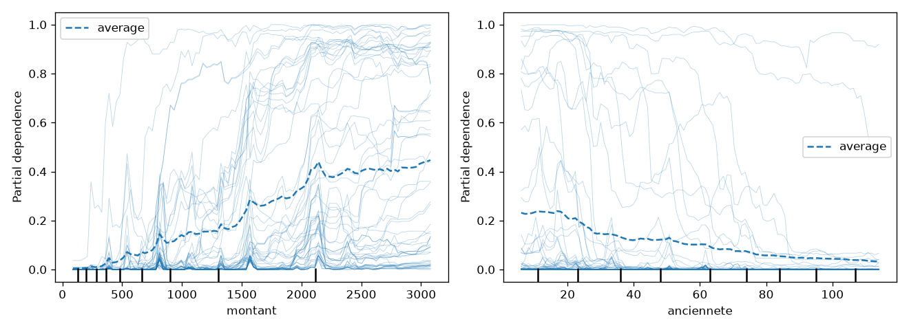

Le risque moyen monte fortement avec le montant, et il baisse avec l'ancienneté. Les courbes ICE montrent que cet effet n'a pas la même ampleur pour toutes les transactions : il est plus fort pour celles qui sont faites de nuit ou par des clients récents.

### Étape 3 — SHAP local : pourquoi ce paiement a été bloqué

```
moyenne du modele : 0.1153
nuit        +0.3677
montant     +0.3555
anciennete  +0.0798
freq_24h    -0.0284
somme : 0.8899
prediction : 0.8899
```

On vérifie la **propriété d'efficacité** : 0,1153 + 0,3677 + 0,3555 + 0,0798 − 0,0284 = **0,8899**, soit exactement la prédiction de la forêt.

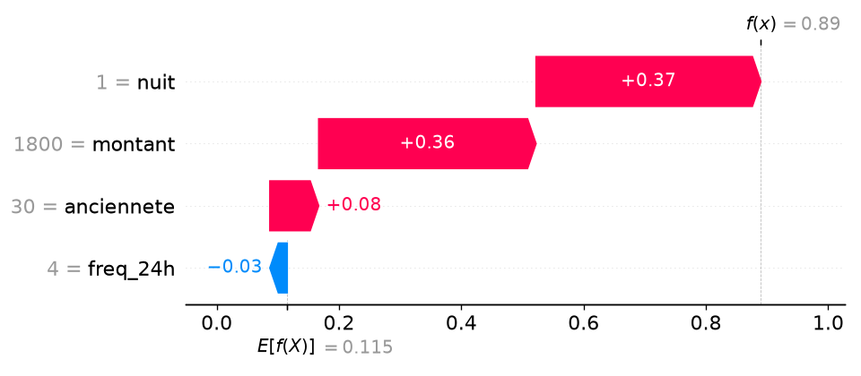

### Étape 4 — SHAP global et dépendance

```
montant       0.1155
anciennete    0.0578
nuit          0.0572
freq_24h      0.0555
```

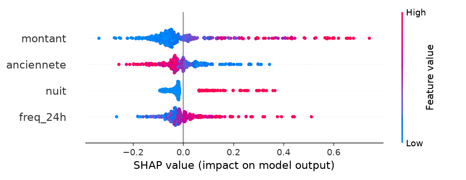

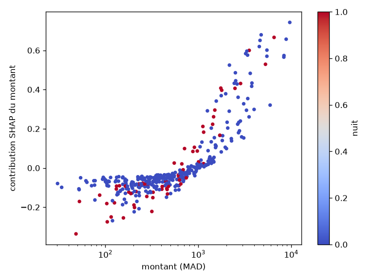

La contribution du montant est presque nulle sous ~1 000 MAD. Au-delà de ce seuil, elle monte vite et dépasse +0,6 vers 10 000 MAD. Les points rouges (paiements de nuit) se trouvent plus haut à montant égal : c'est l'interaction montant × nuit.

### Étape 7 — Démasquer une fuite de données

```
F1 avec la colonne : 0.9323
statut_enquete    0.754
montant           0.285
nuit              0.056
anciennete        0.046
freq_24h          0.045
modele et donnees avec fuite ecrits
```

### Étape 8 — Modèles lisibles : logistique et arbre

```
logistique, montant brut F1 = 0.7407
logistique, log(montant) F1 = 0.8593
coefficients standardises : {'anciennete': -2.58, 'freq_24h': 2.75, 'nuit': 2.23, 'log_montant': 4.93}
cote x 0.928 par mois d'anciennete ; x 4.76 par transaction en 24 h
arbre profondeur 2   :   4 feuilles, F1 = 0.2293
arbre profondeur 3   :   8 feuilles, F1 = 0.5737
arbre profondeur 4   :  16 feuilles, F1 = 0.6063
arbre profondeur 6   :  50 feuilles, F1 = 0.7510
arbre profondeur None: 206 feuilles, F1 = 0.7556
Mme Benali : feuille 13 | P = 0.983
foret : F1 = 0.8636
```

Une seule variable bien construite, **log(montant)**, fait passer la logistique de 0,7407 à 0,8593. Elle arrive ainsi à 0,004 de la forêt. Ses coefficients se lisent directement :
- chaque mois d'ancienneté multiplie la cote de fraude par **0,928** (−7 %) ;
- chaque transaction de plus en 24 h la multiplie par **4,76**.

**L'arbre de profondeur 3 réécrit en règles.** La branche `montant ≤ 1505,7` ne mène qu'à des feuilles de classe 0 ; il reste donc trois feuilles « fraude » :

1. **SI** montant > 1 505,7 **ET** nuit = 0 **ET** ancienneté ≤ 69,5 mois **ALORS** fraude
2. **SI** montant > 1 505,7 **ET** nuit = 1 **ET** ancienneté ≤ 64 mois **ALORS** fraude
3. **SI** montant > 1 505,7 **ET** nuit = 1 **ET** ancienneté > 64 mois **ALORS** fraude

Les règles 2 et 3 se résument en : *montant > 1 505,7 et paiement de nuit → fraude, quelle que soit l'ancienneté*.

**Chemin de Mme Benali** :
- montant 1 800 > 1 505,7 → branche droite ;
- nuit = 1 > 0,5 → droite ;
- ancienneté 30 ≤ 64 → **feuille 13**, classe fraude, P = 0,983 (règle 2).

### Étape 9 — EBM, monotonie, substitut

```
EBM F1 = 0.8538
Mme Benali : {'montant': 5.68, 'anciennete': 1.74, 'freq_24h': 0.04, 'nuit': 4.36} + constante -7.71 -> P = 0.984
boosting sans contrainte  F1 = 0.8390
boosting avec contrainte  F1 = 0.8527
substitut prof. 3 : accord 92.1%, accord sur les fraudes de la foret 56.9%
substitut prof. 5 : accord 95.4%, accord sur les fraudes de la foret 74.6%
```

**Vérification à la main de l'EBM** : −7,71 + 5,68 + 1,74 + 0,04 + 4,36 = **4,11**, et 1 / (1 + e^−4,11) = **0,984**. L'explication est exacte : le modèle n'est rien d'autre que cette somme.

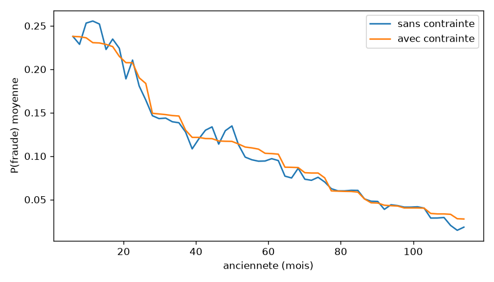

Sans contrainte, le risque **remonte entre 40 et 50 mois** d'ancienneté. Cet effet n'est pas plausible du point de vue métier : c'est un artefact des données. Avec la contrainte (ancienneté −, montant +, freq +, nuit +), la courbe descend sans jamais remonter, et le F1 **augmente** (0,8390 → 0,8527) : imposer le bon sens métier n'a rien coûté.

**Pourquoi 92 % d'accord global cachent 57 % sur les fraudes.** La forêt prédit « légitime » pour environ 89 % des transactions, des cas faciles sur lesquels l'arbre court est presque toujours d'accord. L'accord global est donc dominé par la classe majoritaire. Or, sur les seules transactions que la forêt signale comme fraudes (celles qu'il faudrait justifier au client), l'arbre de profondeur 3 n'est d'accord qu'une fois sur deux. Un substitut doit donc être évalué sur la classe qui compte, et pas seulement sur l'accord global.

---

## 3. Livrable 2 — La phrase et le contrefactuel destinés à Mme Benali

**Les contrefactuels calculés (étape 6) :**

```
situation reelle : P = 0.89
meme paiement de jour : P = 0.098
montant <= 530 MAD : P = 0.415
anciennete >= 92 mois : P = 0.397
```

**La phrase envoyée à la cliente (une ligne, sans jargon) :**

> « Madame, votre paiement de 1 800 MAD a été mis en attente de vérification parce qu'il a été effectué de nuit et que son montant est inhabituel pour votre compte. »

**Le contrefactuel proposé :**

> « Le même paiement effectué en journée aurait été accepté automatiquement. Vous pouvez aussi le confirmer dès maintenant auprès de votre conseiller pour qu'il soit débloqué. »

**Pourquoi ces deux causes.** La phrase cite les deux causes que SHAP donne comme principales et qui sont **stables** dans LIME : nuit (+0,37) et montant (+0,36). L'ancienneté (+0,08) n'est pas citée, car LIME la fait changer de signe selon la graine.

**Les trois contrefactuels :**

| Contrefactuel | P(fraude) | Actionnable ? |
|---|---|---|
| Même paiement **de jour** | 0,098 | **Oui** : la cliente peut refaire le paiement en journée. C'est le contrefactuel le plus court (une seule variable change) et le plus parlant |
| Montant ≤ 530 MAD | 0,415 | En partie : elle peut fractionner son achat, mais un paiement de 1 800 MAD qu'on ramène à 530 MAD ne répond plus à son besoin, et le fractionnement pour éviter un contrôle n'est pas un conseil à donner |
| Ancienneté ≥ 92 mois | 0,397 | **Non** : la cliente ne peut pas « avoir 62 mois d'ancienneté de plus ». Ce contrefactuel est vrai pour le modèle mais inutile, et même vexant, pour elle |

---

## 4. Livrable 3 — Le tableau de stabilité de LIME et le tableau d'équité par groupe

### Stabilité de LIME (étape 5)

Règles retenues par LIME (graine 0) : `montant > 1007.36`, `nuit > 0.00`, `29.00 < anciennete <= 60.00`, `3.00 < freq_24h <= 4.00`.

| Voisinage | Graine | montant | nuit | anciennete | freq_24h |
|---|---|---|---|---|---|
| 500 | 0 | +0,459 | +0,244 | **−0,007** | −0,035 |
| 500 | 1 | +0,499 | +0,245 | **+0,060** | −0,018 |
| 500 | 2 | +0,406 | +0,208 | +0,002 | −0,021 |
| 500 | 3 | +0,384 | +0,192 | +0,015 | −0,028 |
| 500 | 4 | +0,479 | +0,189 | **−0,005** | −0,035 |
| 2 000 | 0 | +0,483 | +0,182 | +0,026 | **+0,001** |
| 2 000 | 1 | +0,429 | +0,236 | +0,032 | **−0,037** |
| 2 000 | 2 | +0,440 | +0,180 | +0,025 | **+0,012** |
| 2 000 | 3 | +0,455 | +0,205 | +0,020 | −0,016 |
| 2 000 | 4 | +0,455 | +0,228 | +0,034 | −0,003 |

**Lecture :**
- **Stables** : le montant (+0,38 à +0,50) et la nuit (+0,18 à +0,25) gardent le même signe et le même ordre sur les 10 tirages.
- **Instables** : avec 500 voisins, l'ancienneté change de signe (−0,007 / +0,060). Avec 2 000 voisins, elle se stabilise, mais c'est alors la fréquence qui change de signe (−0,037 / +0,012).
- Augmenter le voisinage réduit l'instabilité sans la supprimer.

### Équité par groupe (étape 10, Fairlearn)

| Groupe | Taux d'alerte | Fausses alertes (FPR) | Rappel | Taux réel de fraude |
|---|---|---|---|---|
| A | 7,83 % | **1,08 %** | 84,62 % | 8,07 % |
| B | 15,06 % | **2,13 %** | 85,51 % | 15,51 % |
| **Écart** | 7,23 pts | **1,05 pt** | 0,89 pt | — |

Le rappel est presque le même dans les deux groupes : le modèle attrape les fraudes aussi bien partout. En revanche, **les clients honnêtes du groupe B subissent deux fois plus de fausses alertes** (2,13 % contre 1,08 %), alors que le modèle ne voit jamais le groupe (réponse 6).

---

## 5. Livrable 4 — La fiche modèle complétée, journalisée dans MLflow

La fiche `MODEL_CARD.md` (racine du dépôt) reprend les valeurs préremplies du TP. Elle est complétée sur deux rubriques.

**Rubrique « Limites connues » :**
- données synthétiques (5 000 lignes, 4 variables) : les performances réelles restent à mesurer ;
- environ 15 % des fraudes manquées et 12 % de fausses alertes : la revue humaine est indispensable ;
- le montant domine (59 % de l'importance par permutation) : un changement d'échelle des montants (inflation, devise, ou la version v2 du TP 4 avec les montants × 1,3) déplace tous les seuils, donc il faut surveiller la dérive ;
- la forêt n'impose aucune monotonie : le risque remonte vers 45 mois d'ancienneté ;
- l'ancienneté sert de variable proxy (groupe B : deux fois plus de fausses alertes) ;
- LIME est instable sur l'ancienneté et la fréquence : on ne communique au client que les causes SHAP stables ;
- les variables connues après la décision sont interdites (garde-fou Prefect de l'étape 14).

**Rubrique « Revue »** : auteur, et revue prévue dans 6 mois (mai 2027).

**Journalisation (`python src/journaliser.py`).** Le script :
- crée le run `xai-foret-v1` dans l'expérience `tp8-explicabilite` ;
- dépose les 5 graphiques dans le dossier `explications/` ;
- journalise les métriques `f1 = 0.8636` et `ecart_fausses_alertes = 0.0105` (l'équité devient une métrique suivie comme la performance) ;
- ajoute l'artefact `MODEL_CARD.md` et le tag `revue = a valider par le metier`.

Sortie : `explications et fiche modele journalisees`.

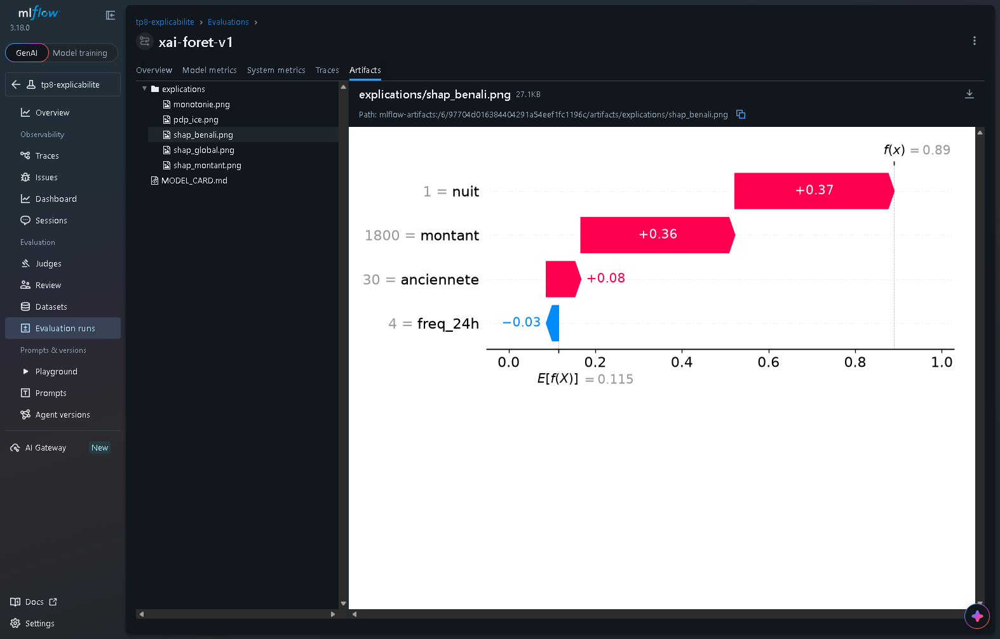

---

## 6. Livrable 5 — Partie B : Orange, H2O et Prefect

### Étape 12 — Orange : les mêmes explications sans code

Workflow enregistré dans `workflows/explication-tp8.ows`. Ses widgets :
- **File** sur `transactions.csv` (`fraude` en target / categorical) → **Data Sampler** (75 %, replicable, stratified) → **Random Forest** (100 arbres, Replicable training) ;
- **Feature Importance**, **Explain Model** et **ICE** : chacun reçoit le *Model* de Random Forest et la *Remaining Data* du Data Sampler ;
- **Explain Prediction** : *Model* de Random Forest, *Background Data* = *Data Sample* du Data Sampler, *Data* = un second widget **File** qui lit `data/benali.csv` (`montant,anciennete,freq_24h,nuit` puis `1800.0,30,4,1`) ;
- Target class réglée sur **1** dans Explain Model, ICE et Explain Prediction ; variable **montant** dans ICE.

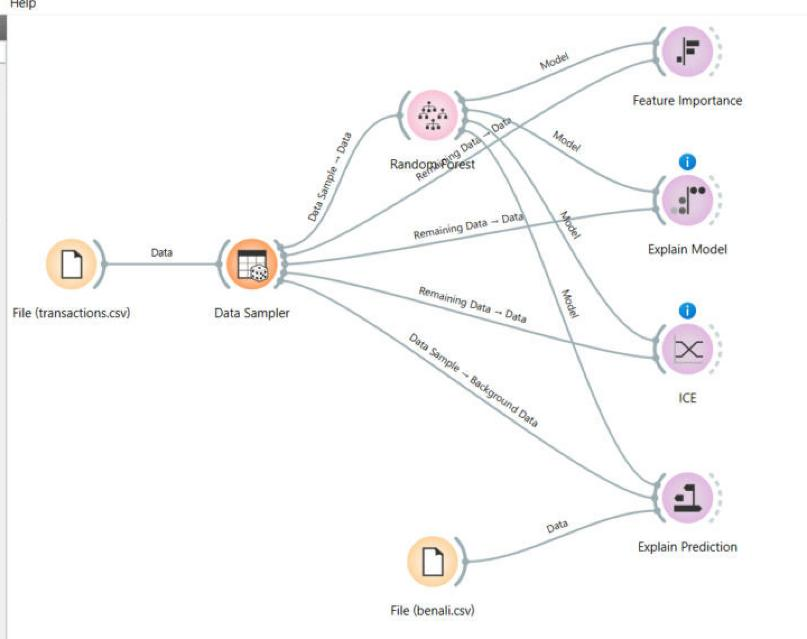

**Explain Prediction (Mme Benali, classe cible 1)** : prédiction **0,91**, valeur de base **0,11**. Contributions :
- montant = 1800 : **+0,38** ;
- nuit=0 : **+0,18** et nuit=1 : **+0,17** (total **+0,35**) ;
- anciennete = 30 : **+0,09** ;
- freq_24h : petite contribution négative (la pointe bleue en haut, ≈ −0,03).

Avant de passer la classe cible à 1, le widget affichait prédiction 0,09 et base 0,89 : c'est le cas « si ça coince » de l'énoncé, corrigé en réglant la classe cible.

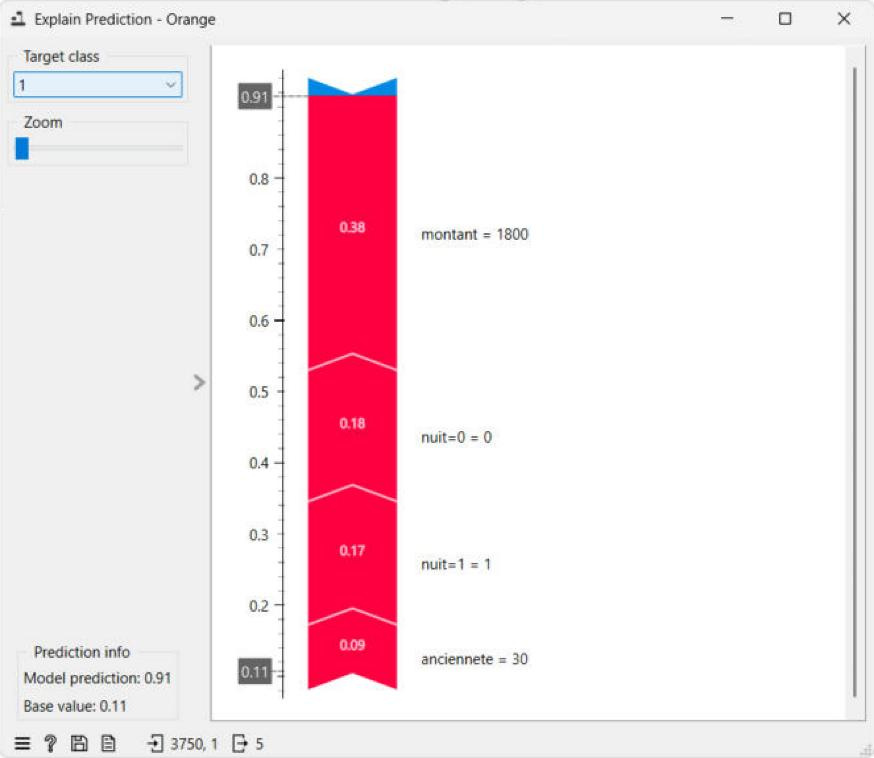

**Feature Importance** (baisse d'AUC, 5 permutations) : **montant ≈ 0,27 > nuit ≈ 0,09 > freq_24h ≈ 0,08 > anciennete ≈ 0,06**. Le classement est celui du cours.

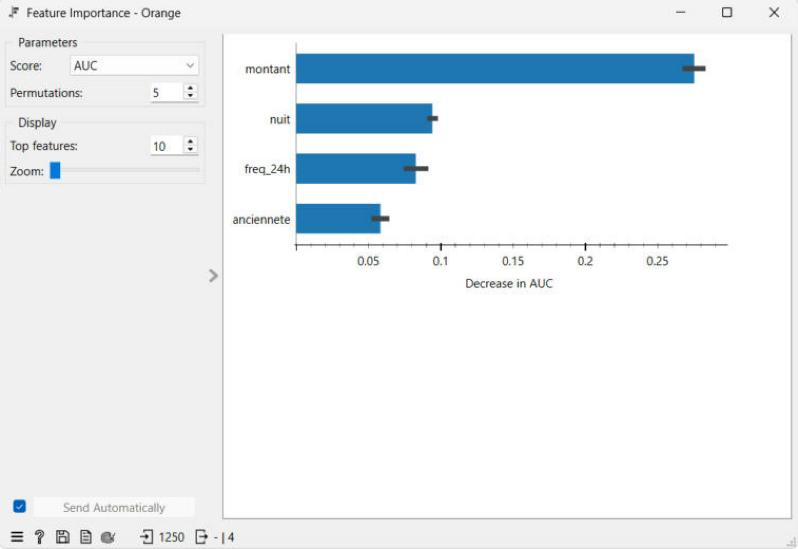

**Explain Model** : le nuage se lit comme le beeswarm de l'étape 4.
- Montant élevé (rouge) : contributions fortement positives.
- Ancienneté élevée : contributions négatives.
- nuit=1 : bloc de contributions positives, séparé de nuit=0.

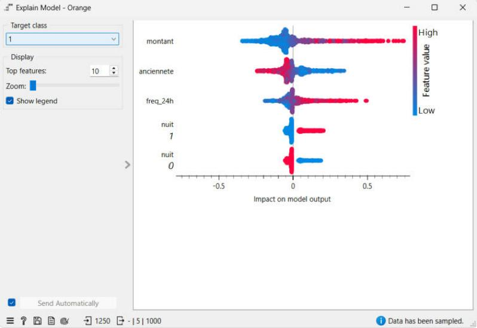

**ICE** (montant, classe 1, centré) : la courbe moyenne (jaune) part de 0, monte fortement entre ~500 et ~4 000 MAD, puis plafonne vers +0,8. C'est la même forme que le PDP de l'étape 2.

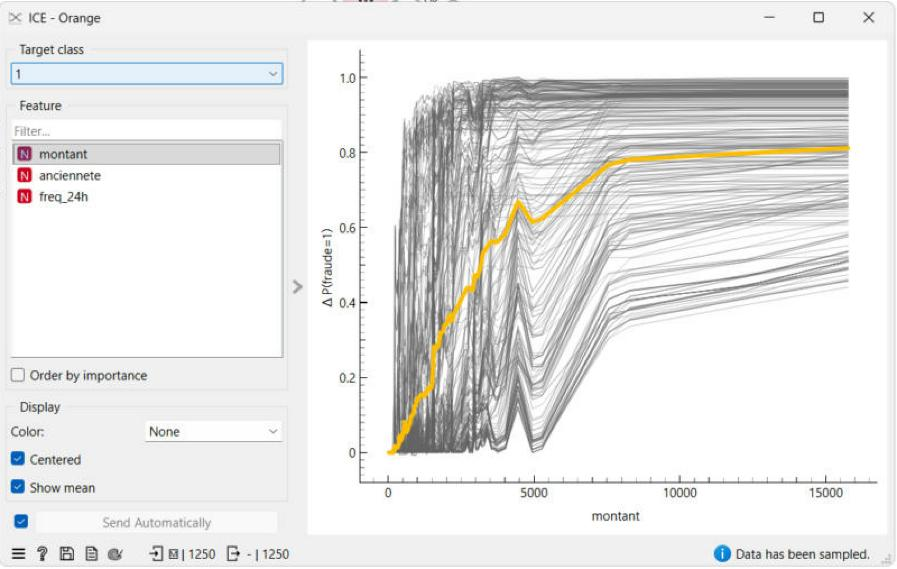

**Les deux différences avec la partie A :**
1. Orange traite `nuit` comme une variable catégorielle : elle devient deux colonnes (nuit=0, nuit=1), et sa contribution est partagée entre elles (0,18 + 0,17).
2. Ce n'est pas le même modèle : 100 arbres et un autre découpage, d'où 0,91 au lieu de 0,89. Le diagnostic, lui, est le même : **montant et nuit**.

### Étape 13 — H2O : expliquer le modèle de la plateforme AutoML

Plateforme lancée comme au TP 6 (`java -jar h2o.jar -port 54321`), puis `python src/h2o_xai.py` :

```
AutoML: XGBoost is not available; skipping it.
XGBoost indisponible sur cette plateforme : on explique le meilleur GBM
modele explique : GBM_1_AutoML_1_20261112_153022
  variable  scaled_importance
   montant              1.000
  freq_24h              0.399
anciennete              0.340
      nuit              0.279
Mme Benali (log-cote) : {'montant': 4.407, 'anciennete': 1.327, 'freq_24h': -0.128, 'nuit': 3.648, 'BiasTerm': -5.846}
P(fraude) = 0.968
graphique ecrit
```

**Vérification** : −5,846 + 4,407 + 1,327 − 0,128 + 3,648 = **3,408**, et 1 / (1 + e^−3,408) = **0,968**. Les contributions H2O sont en **log-cote**, avec un terme constant (BiasTerm), et leur somme redonne exactement la prédiction.

Sous Windows, H2O n'embarque pas XGBoost (constaté dès le TP 6), donc `get_best_model(algorithm='xgboost')` renvoie `None`. Le script explique alors le meilleur **GBM**, lui aussi un modèle d'arbres qui fournit des contributions SHAP exactes. Le diagnostic est le même que celui du cours : montant et nuit sont les deux causes principales, avec une ancienneté qui pousse vers la fraude.

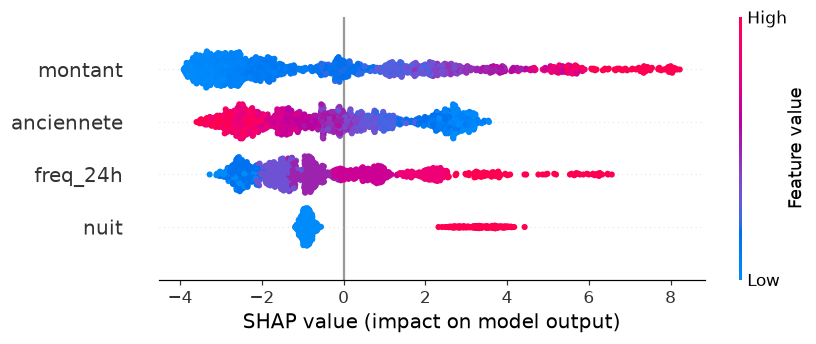

### Étape 14 — Prefect : un garde-fou d'explicabilité automatique

Serveur Prefect du TP 7 démarré (`prefect server start`), `PREFECT_API_URL=http://127.0.0.1:4200/api`.

**Premier lancement** (`python src/flow_xai.py`, modèle du TP 3) :

```
Task run 'expliquer-670' - Finished in state Completed()
Task run 'controler-796' - importances : montant 0.586, freq_24h 0.283, anciennete 0.264, nuit 0.194
Task run 'controler-796' - explications plausibles : montant en tete (44%)
Task run 'controler-796' - Finished in state Completed()
Flow run 'gracious-prawn' - Finished in state Completed()
```

**Deuxième lancement** (`python src/flow_xai.py models/model_fuite.pkl data/transactions_fuite.csv`, modèle « tricheur » de l'étape 7) :

```
Task run 'controler-0ae' - importances : statut_enquete 0.754, montant 0.285, nuit 0.056, anciennete 0.046, freq_24h 0.045
Task run 'controler-0ae' - Task run failed with exception: ValueError("variables non autorisees : ['statut_enquete']")
Flow run 'unique-chicken' - Finished in state Failed(...)
```

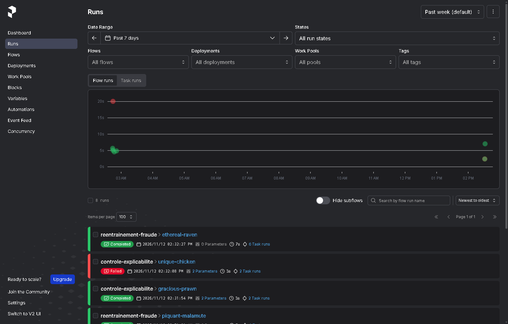

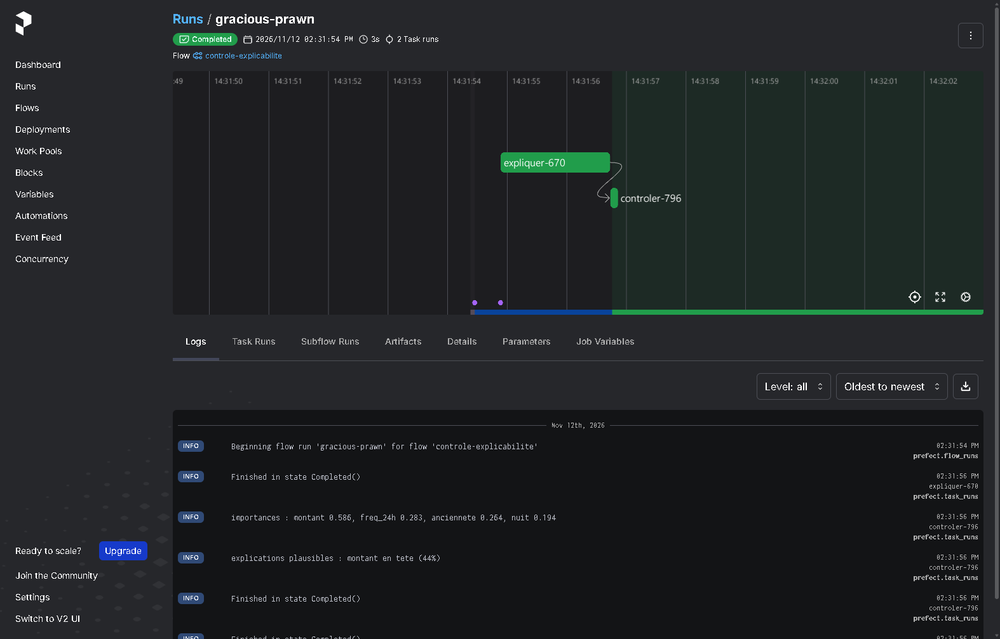

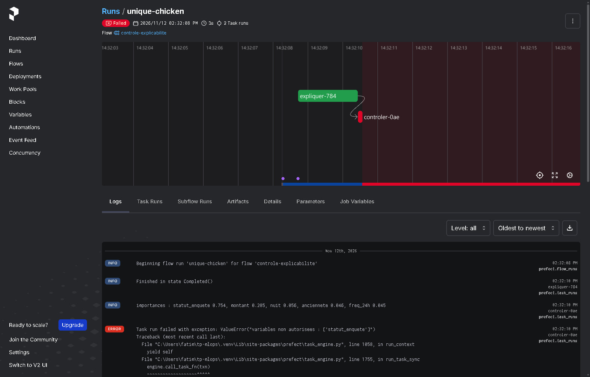

**Ajout au flux du TP 7.** Dans `flow_mlops.py`, les tâches `expliquer` et `controler` sont maintenant appelées entre `valider` (l'évaluation) et `notifier`. L'exécution `ethereal-raven` du flux `reentrainement-fraude` passe les 6 tâches au vert. Les journaux de la tâche `controler` affichent « explications plausibles : montant en tete (44%) », puis la notification part.

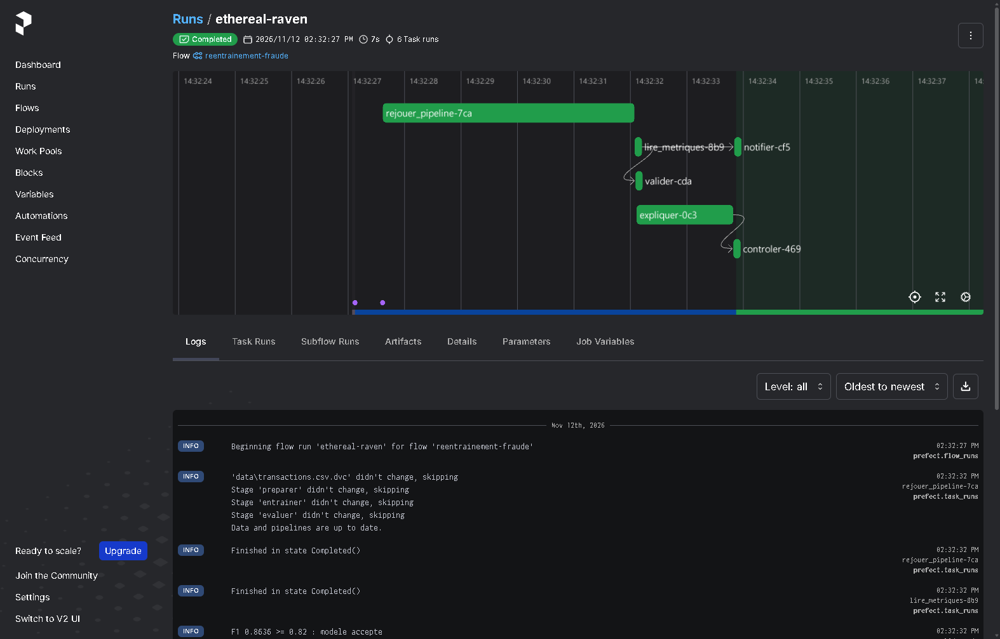

---

## 7. Livrable 6 — Tableau de synthèse « même dossier, cinq outils »

Le dossier : Mme Benali, 1 800 MAD, de nuit, 30 mois d'ancienneté, 4 transactions en 24 h.

| Outil | Prédiction pour Mme Benali | Deux causes principales | Forme de l'explication | Exacte ou approchée | Code nécessaire |
|---|---|---|---|---|---|
| Forêt + SHAP (Python) | P = 0,890 | nuit +0,37, montant +0,36 | contributions en **probabilité** (base 0,115) | **exacte** (TreeExplainer, somme = prédiction) | Python, ~10 lignes |
| Forêt + LIME (Python) | P = 0,890 | montant +0,45, nuit +0,21 (moyenne de 5 graines, 2 000 voisins) | **règles** (`montant > 1007.36`, `nuit > 0`) pondérées | **approchée** (modèle linéaire local, varie selon la graine) | Python, ~15 lignes |
| EBM (InterpretML) | P = 0,984 | montant +5,68, nuit +4,36 | contributions en **log-cote** (constante −7,71) | **exacte** (le modèle est la somme des courbes) | Python, ~5 lignes |
| Orange, Explain | P = 0,91 | montant +0,38, nuit +0,35 (0,18 + 0,17) | contributions en **probabilité** (base 0,11) | approchée (SHAP échantillonné sur le fond Data Sample) | **sans code** (widgets à la souris) |
| H2O GBM (XGBoost indisponible) | P = 0,968 | montant +4,41, nuit +3,65 | contributions en **log-cote** (BiasTerm −5,85) | **exacte** (TreeSHAP natif d'H2O) | Python, ~15 lignes, plateforme Java |

**Lecture du tableau :**
- Les cinq outils désignent les **mêmes deux causes, montant et nuit**, avec l'ancienneté loin derrière. Le diagnostic est robuste au changement d'outil.
- Les prédictions vont de 0,89 à 0,98, parce que ce ne sont pas les mêmes modèles.
- Les ordres de grandeur diffèrent (probabilité ou log-cote) : on ne peut comparer que les classements et les signes.

---

## 8. Réponses aux questions

**1. Phrase destinée à Mme Benali et contrefactuel. Pourquoi pas « ayez 92 mois d'ancienneté » ?**

- **Phrase** : « Votre paiement de 1 800 MAD a été mis en attente de vérification parce qu'il a été effectué de nuit et que son montant est inhabituel pour votre compte. »
- **Contrefactuel** : « Le même paiement effectué en journée aurait été accepté » (P passe de 0,89 à 0,10).

On ne propose pas « ayez 92 mois d'ancienneté » parce qu'un contrefactuel doit être **actionnable** : la cliente ne peut pas changer son ancienneté. Ce conseil serait vrai pour le modèle mais inutile, et même vexant, pour elle (« revenez dans 5 ans »). Le contrefactuel « de jour » ne change qu'une variable, sur laquelle elle a prise.

**2. MDI, permutation et SHAP global donnent-ils le même classement ? Différence sur `nuit` (MDI 0,093, permutation 0,193).**

Les trois mesures mettent le **montant en tête**, mais l'ordre des trois autres variables diffère :

| Mesure | Classement |
|---|---|
| MDI | anciennete > freq_24h > nuit |
| Permutation | freq_24h ≈ anciennete > nuit |
| SHAP global | anciennete ≈ nuit ≈ freq_24h (0,058 / 0,057 / 0,056) |

Seul le leader est robuste. Pour les autres variables, les écarts sont dans le bruit, et la mesure choisie décide de l'ordre.

**La différence sur `nuit`** vient du biais de la MDI. Elle additionne la baisse d'impureté à chaque coupure, ce qui favorise les variables continues : elles offrent des centaines de seuils possibles et sont coupées très souvent. `nuit` est binaire : elle n'offre qu'une coupure par branche, donc elle accumule peu d'impureté, même quand cette coupure est décisive. La permutation mesure au contraire **ce que le modèle perd** quand on brouille la variable sur le jeu de test. Mélanger `nuit` fait perdre 0,193 de F1, deux fois plus que ce que suggère la MDI. De plus, la MDI se calcule sur l'entraînement, et la permutation sur le test.

**3. LIME : quelles contributions sont stables, lesquelles changent de signe ? Quelle règle adopter ?**

- **Stables** : montant (+0,38 à +0,50) et nuit (+0,18 à +0,25), sur les 10 tirages.
- **Changent de signe** : l'ancienneté avec 500 voisins (−0,007 / +0,060), et la fréquence avec 2 000 voisins (−0,037 / +0,012).

**Règle à adopter** : on ne communique au client qu'une cause **stable**. Concrètement :
- relancer l'explication avec plusieurs graines et un voisinage assez grand ;
- ne garder que les contributions qui gardent le même signe et un ordre de grandeur constant ;
- les confirmer par une méthode exacte (SHAP TreeExplainer) quand le modèle le permet.

Une cause dont le signe dépend du hasard ne peut pas être expliquée à un client ni défendue devant un régulateur.

**4. Étape 7 : quelle information a révélé la fuite, et pourquoi un F1 de 0,93 aurait-il dû alerter ?**

C'est **l'importance par permutation** qui a révélé la fuite. `statut_enquete` pèse 0,754, plus de 2,5 fois le montant (0,285), alors qu'elle n'existe qu'**après** l'enquête de la banque, donc jamais au moment de décider. L'importance des autres variables s'effondre (nuit 0,056 au lieu de 0,193).

Un F1 de 0,93 aurait dû alerter à lui seul, pour deux raisons :
- il saute de +0,07 d'un coup avec **une seule colonne ajoutée**, alors que les modèles soignés de l'étape 8 et de l'étape 9 plafonnent tous autour de 0,85–0,86 ;
- en détection de fraude, un gain aussi brutal est presque toujours le signe que le modèle « lit la réponse ».

La bonne réaction est de demander *d'où vient cette colonne et quand elle est connue*, et non de se réjouir.

**5. Logistique + log(montant) 0,8593 contre forêt 0,8636 : quel modèle en production pour bloquer des paiements ?**

**La logistique avec log(montant).** L'écart de F1 est de 0,004, soit moins d'une fraude sur les 142 du jeu de test. En échange :
- le modèle est **transparent par construction** : chaque coefficient se lit (×0,928 par mois d'ancienneté, ×4,76 par transaction en 24 h) ;
- l'explication d'une décision est exacte et identique pour tous ;
- les effets sont monotones, sans artefact comme la remontée à 45 mois ;
- il est simple à auditer, à reproduire et à défendre.

Bloquer un paiement est une décision qui affecte directement le client : la loi 09-08 (art. 11) exige qu'elle puisse être expliquée et revue par un humain. À performance quasi égale, on préfère le modèle qu'on comprend. L'EBM (0,8538) est une alternative tout aussi lisible. La forêt reste utile comme modèle de référence (« challenger ») pour vérifier que la logistique ne décroche pas.

**6. Pourquoi les clients honnêtes du groupe B ont-ils deux fois plus de fausses alertes ? Quelle métrique d'équité ?**

Le modèle ne voit pas le groupe, mais il voit l'**ancienneté**, qui sert de **variable proxy** : le groupe B est plus fréquent chez les clients récents (moins de 24 mois). Or une faible ancienneté augmente le risque prédit (SHAP, coefficient −2,58). Un client honnête mais récent a donc plus de chances de dépasser le seuil. Le groupe B contient plus de ces clients, d'où 2,13 % de fausses alertes contre 1,08 %. Retirer le groupe des variables ne suffit pas à rendre un modèle équitable.

**Métrique choisie : l'écart de taux de fausses alertes (FPR)**, c'est-à-dire l'égalité des chances au sens de l'*equalized odds* côté négatifs.
- Le préjudice de ce modèle, c'est de bloquer à tort le paiement d'un client honnête : c'est exactement ce que mesure le FPR.
- La parité démographique (même taux d'alerte) serait trompeuse ici, car les taux réels de fraude diffèrent (15,5 % contre 8,1 %). L'imposer obligerait à rater des fraudes dans B ou à inventer des alertes dans A.
- Le rappel est déjà équilibré (0,85 / 0,86).

C'est la métrique `ecart_fausses_alertes = 0.0105` journalisée dans MLflow.

**7. Orange partage `nuit` entre deux colonnes et H2O donne des log-cotes : comment comparer honnêtement ?**

- **Ramener les explications sur la même échelle** : soit tout en probabilité, soit tout en log-cote (via logit(p) = ln(p / (1 − p))). Ne jamais comparer +0,36 (probabilité) à +3,65 (log-cote).
- **Regrouper les colonnes issues d'une même variable** : nuit=0 + nuit=1 = +0,35 dans Orange, comparable aux +0,37 de SHAP.
- **Vérifier la propriété d'efficacité** dans chaque outil (base + somme = prédiction) : c'est ce que nous avons fait pour SHAP, l'EBM et H2O.
- **Comparer ce qui est comparable** : les **classements** et les **signes** des causes, pas les valeurs brutes, puisque les modèles diffèrent (300 ou 100 arbres, GBM, EBM, découpages différents).
- Préciser pour chaque outil s'il est **exact** ou **approché**, et sur quel jeu de fond (*background*) il est calculé.

Ainsi comparés, les cinq outils concordent : montant et nuit en tête, ancienneté ensuite.

**8. Si la colonne fautive s'appelait `montant_verifie`, quel garde-fou la détecterait encore ? Part de la variable en tête.**

Le garde-fou 1 est une **liste blanche** (`AUTORISEES`) : toute colonne absente de la liste est refusée, donc `montant_verifie` serait elle aussi refusée tant que personne ne l'ajoute à la liste. Mais un nom rassurant, proche de `montant`, pousse justement à l'ajouter.

Le garde-fou qui la détecte **quel que soit son nom** est le **garde-fou 2** (une variable écrase les autres). Sur le modèle tricheur :

part = 0,754 / (0,754 + 0,285 + 0,056 + 0,046 + 0,045) = 0,754 / 1,186 = **63,6 % > 60 %**

Le modèle serait donc refusé. À comparer avec le bon modèle : montant 0,586 / 1,327 = 44 %. Ce seuil reste fragile : une fuite plus « bruitée » pourrait passer sous 60 %. Il faut donc le compléter par :
- une alerte sur un saut anormal de F1 (0,86 → 0,93) ;
- la traçabilité de la provenance de chaque colonne (date à laquelle elle est connue).

**9. Quels éléments de ce TP permettraient de reconstituer la décision de Mme Benali dans six mois ?**

- **Les données exactes** : `data/transactions.csv.dvc` (md5 `cf9f6f86…`) et `dvc.lock`, qui permettent `dvc checkout` de la même version.
- **Le modèle exact** : `models/model.pkl`, reproduit par `dvc repro` avec `params.yaml` (300 arbres, profondeur 12, graine 42), et son hash dans `dvc.lock`.
- **Le code** : le commit Git (`87e711f` et suivants) avec `src/xai_commun.py` (le dossier `CAS`) et `src/xai_local.py`. TreeExplainer est exact et déterministe, donc relancer le script redonne 0,1153 / +0,3677 / +0,3555 / 0,8899 au chiffre près.
- **Le run MLflow `xai-foret-v1`** : `shap_benali.png` (l'explication telle qu'elle a été produite), les métriques F1 et équité, et la fiche modèle de cette version.
- **`MODEL_CARD.md`** : usage prévu, limites, revue.
- **`reports/tp8_sorties.txt`** : les sorties brutes horodatées par le commit.
- **Les versions des bibliothèques** (§ 1), à figer dans un fichier de dépendances pour garantir le même résultat.

Pour une vraie banque, il faudrait en plus journaliser **la requête elle-même** (identifiant de transaction, horodatage, version du modèle servie, score et explication renvoyés) au moment de la décision.

---

## 9. Écarts avec l'énoncé

| Écart | Cause | Effet |
|---|---|---|
| **Données remises en version v1** (`data/transactions.csv.dvc` revenu au md5 `cf9f6f86…` du TP 3, puis `dvc repro`) | Le dépôt contenait la **v2 du TP 4**, où tous les montants sont multipliés par 1,3. Avec la v2, le dossier de Mme Benali (1 800 MAD) donnait P = 0,6738 au lieu de 0,8899, et les seuils de montant étaient ×1,3 (arbre : 1 957,4 au lieu de 1 505,7). Les F1 étaient identiques : la forêt est insensible à un changement d'échelle | Avec la v1 (celle du modèle du TP 3 demandé en prérequis), **tous les points de contrôle du cours sont retrouvés** à la décimale près. La v2 reste dans l'historique Git (commit `bacc892`) et dans le cache DVC |
| MLflow sur le port **5001** | Le port 5000 est occupé par une autre application du poste (comme aux TP 6 et 7) | `src/journaliser.py` lit `MLFLOW_TRACKING_URI` (5000 par défaut, comme l'énoncé) ; lancé avec `MLFLOW_TRACKING_URI=http://127.0.0.1:5001` |
| H2O : **GBM_1** expliqué au lieu de XGBoost_2 | XGBoost n'est pas disponible dans H2O sous Windows (« XGBoost is not available; skipping it », déjà constaté au TP 6) | Le script explique le meilleur GBM s'il n'y a pas de XGBoost. P = 0,968 au lieu de 0,975 ; mêmes deux causes principales |
| EBM : 5,68 / 4,36 / −7,71 au lieu de 5,69 / 4,37 / −7,73 | interpret 0.7.8 et scikit-learn 1.9.1 (différences d'arrondi des intervalles) | P = 0,984 et F1 = 0,8538 identiques |
| Add-on Explain installé avec `pip` dans l'environnement d'Orange | La commande de l'énoncé vise `$HOME\orange-env`, qui n'existe pas ici : Orange est installé dans `AppData\Local\Programs\Orange` | L'installation a mis à jour scikit-learn de 1.5.2 à 1.9.1 dans l'environnement d'Orange. Orange 3.40 démarre et calcule normalement |
| Workflow Orange préparé par script, puis réglé dans Orange | Le fichier `.ows` a été construit avec les mêmes widgets, liens et réglages que l'énoncé (en reprenant le widget File du TP 5, où `fraude` est déjà cible catégorielle), puis ouvert dans Orange | Dans Orange : classe cible passée à 1 dans les trois widgets, variable montant dans ICE, puis `Ctrl+S` |
| `flow_mlops.py` modifié | L'énoncé demande d'ajouter le contrôle au flux du TP 7 | Les tâches `expliquer` et `controler` sont importées de `src/flow_xai.py` et appelées entre `valider` et `notifier` |
